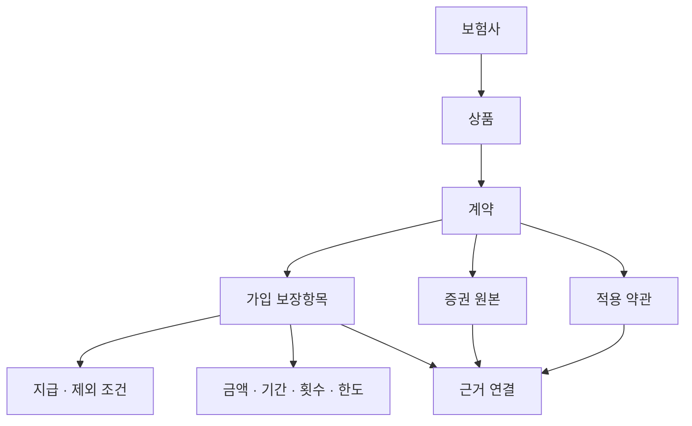

# 항목별 데이터베이스 설계서

작성일: 2026-11-09 (한국시간)
문서 상태: 설계 문서. 앱 구현·보안 감사·실제 보험금 계산을 완료했다는 뜻이 아니다.
정리 범위: 이 대화에서 갑상선암 검색 예시부터 단일 HTML·로그인 추후 추가 결정 및 문서화 요청까지의 요구·설명·구조·보안 대응. 다른 대화·기존 첨부 보험자료의 전문이나 기존 DB 파일을 재분석한 결과는 아니다.
근거 구분: 사용자 요구는 이 대화를 출처로 하며, 기술 근거는 통합지침서의 출처 목록을 참고한다. 이 문서에 실제 계약·약관 조항이나 개인별 지급금액을 새로 확정하지 않는다.

## 1. 목적과 범위

본인 한 명만 사용하는 보험상품 통합 DB다. 본인이 등록한 증권과 약관을 보험사별·상품별·계약별·보장항목별로 연결한다. 질병명·진단코드를 입력하면 가입 보장과 대조하고 예상 지급금액 및 그 근거까지 열람한다. 국내 전체 상품을 무조건 포함한 DB나 보험사 지급결정을 대신하는 시스템으로 표현하지 않는다.

공통 연결 규칙·용어사전·질병코드 DB와 개인 보험상품 DB를 분리한다. 새 보험을 가입하면 ‘내 보험 추가하기’로 해당 증권·약관을 추가하고 기존 DB를 유지한다. 사용자 수정·삭제도 지원한다.

## 2. 반드시 필요한 5개 항목

| ID | DB·규칙 | 입력 | 출력·연결 |
|---|---|---|---|
| DB-01 | 약관·증권 → 내 보험정보 구성 규칙 | 증권·약관 원본과 추출 문장 | 보험사·상품·계약·가입 보장·가입금액 |
| DB-02 | 증권 ↔ 적용 약관 연결 규칙 | 상품 식별자·특약명·계약일·약관 버전 | 적용 가능한 약관·조항·근거 페이지 |
| DB-03 | 보험사별 언어 통합사전 | 회사·보장·특약·지급 표현 | 공통 개념·별칭·원문 표현 |
| DB-04 | 질병코드 DB | 질병명·유사 표현·진단코드 | 정식 명칭·후보 코드·분류 버전 |
| DB-05 | 질병코드 ↔ 내 보험정보 연결 규칙 | 코드·가입 특약·약관·사건 조건 | 보장 후보·조건 판정·예상금액·근거 |

## 3. 개인 DB의 관계

회사나 상품명이 같아도 계약을 합치지 않는다. 약관에 실린 특약 전체를 가입 보장으로 간주하지 않는다. 하나의 약관 원본을 여러 계약이 참조할 수 있으므로 원본과 연결을 별도 관리한다.

## 4. 데이터 구조 제안

다음은 구현 제안 필드이며 실제 채워진 DB는 아니다.

| 데이터 | 주요 필드 |
|---|---|
| 보험사 | insurerId, 원래 회사명, 표준 회사명, 별칭, 명칭 적용기간, 근거 |
| 상품 | productId, insurerId, 원문 상품명, 상품 식별정보, 판매·개정 시기 |
| 계약 | contractId, productId, 계약일, 보장개시·종료일, 상태, 증권 연결 |
| 자료 | documentId, 종류, 원래 파일명, 형식, 크기, 해시, 암호화 원본, 등록일 |
| 페이지 추출 | documentId, page, 추출 상태, 추출 문장, 추출 방법, 오류 |
| 보장 | coverageId, contractId, 원문 특약명, 표준 보장 개념, 가입금액·단위, 기간 |
| 약관 | termsId, documentId, 상품 식별정보, 버전, 적용기간, 확인 상태 |
| 조항 | clauseId, termsId, 조항·별표 제목, 페이지, 근거 문장 |
| 근거 연결 | evidenceId, 대상 ID, documentId, page, clauseId, 원문 구간, 확인 상태 |
| 지급 조건 | ruleId, coverageId, 질병 범위, 사건 유형, 날짜 조건, 지급식, 제외·횟수·한도 |
| 질병 | codeSystem, version, code, 정식 명칭, 상하위 코드, 별칭, 출처 |
| 검색·계산 | searchId, 입력, 선택 코드, 사건 조건, 계약별 결과, 계산식, 사용 규칙 버전 |
| 청구·메모 | 결과 연결, 미청구·청구함·모름, 메모·근거 |
| 수정 이력 | 대상 ID, 변경 전후, 변경일, 근거, 복구 가능 상태 |
| 화면 상태 | 경로, 선택 보험·보장, 필터, 최근 검색·탭·스크롤 위치 |
| 보안 메타데이터 | 스키마 버전, 암호화 방식·버전, salt, IV, KDF 설정, 암호문 |

계약번호 등 식별정보가 필요한 경우도 암호화한다. 원문 전체를 파일명·로그·검색 인덱스에 평문으로 중복 저장하지 않는다.

## 5. DB-01: 내 보험정보 구성

1. 증권과 약관을 등록하고 파일별 미리보기·마스킹 확인을 제공한다.
2. 브라우저 내부에서 텍스트를 추출한다. 스캔은 내장 OCR을 사용할 수 있는지 검증하고 실패하면 직접 입력을 지원한다.
3. 보험사·상품·가입시기·특약·가입금액·기간·단위를 후보로 추출한다.
4. 성공한 페이지와 실패한 페이지를 분리 저장한다. 재시작 시 완료 페이지를 중복 처리하지 않고 미완료 페이지를 이어서 처리하는 방식을 개발 검증 대상으로 둔다.
5. 사용자가 확인·수정한 뒤 계약과 가입 보장으로 저장한다.
6. 동일 파일은 해시로 후보 중복을 알리되, 동일 자료로 보인다고 다른 계약을 자동 병합하지 않는다.
7. PDF 파일 비밀번호는 앱 잠금 비밀번호와 다르며 사용자가 입력하고 원문 비밀번호를 저장하지 않는다.

## 6. DB-02: 증권과 약관 연결

보험사·상품명만으로 확정하지 않는다. 계약일·상품 버전·특약 원문명·특약 식별정보·약관 적용기간을 대조한다. 증권의 가입 사실과 약관의 보장 정의를 함께 확인한다. 연결 후보와 근거를 제시하고 사용자 확인을 거친다.

상태는 ‘후보 / 확인 완료 / 불일치 / 근거 부족’으로 구분한다. 불일치·근거 부족은 지급가능 합계에 포함하지 않는다. 관련 원본 변경 시 기존 연결과 계산을 재검토 대상으로 표시한다.

## 7. DB-03: 보험사별 통합사전

보험사별 표현을 공통 개념으로 연결하되 원문명·출처·적용 버전·범위를 유지한다. 비슷한 이름이라는 이유만으로 같은 보장·같은 지급식으로 확정하지 않는다. 옛 명칭은 별칭과 명칭 적용기간으로 연결할 수 있으나 실제 변경 사실과 승계 관계는 별도 근거가 있어야 한다. 검색 편의용 용어 연결이 계약 지급기준을 덮어쓰지 않는다.

## 8. DB-04: 질병코드

정식 질병명·진단코드·분류체계·버전·출처·유효 시기·별칭을 함께 관리한다. 이름이 모호하면 후보를 제시하고 직접 선택·수정하게 한다. 질병 검색은 의료적 진단을 제공하는 기능이 아니다. 특정 코드의 범위와 적용 약관 분류표를 확인한다. 공식 코드 데이터의 확보·이용조건·내장 용량은 개발 전 검증한다.

## 9. DB-05: 질병과 내 보장 연결

선택 코드 → 계약별 가입 특약 → 적용 약관의 질병 범위 → 실제 사건·날짜 조건 → 제외·감액·기간·횟수·한도 → 계산식 순으로 처리한다. 수술 여부·입원일수·실제 지출처럼 부족한 정보는 추가 확인한다.

실손은 계약·세대·특약·자기부담·보장범위에 맞는 근거를 확보했을 때 계산한다. 질병코드만으로 실손 금액을 산출하지 않는다. 정액 보장과 실손을 구분하고, 계약별 결과 및 동일 담보·비례보상 관련 확인 사항을 표시한다.

## 10. 검색 결과와 상세보기

보험사, 상품, 계약, 특약, 가입금액, 지급가능 여부, 예상금액, 조건 충족 여부, 기간·횟수·한도, 청구 상태, 근거를 표시한다. 상태는 ‘조건 충족에 따른 추정 / 확인 필요 / 해당 없음 / 계산 대기’를 구분한다. 지급 여부와 금액을 별도로 표시한다. 미확인은 0원으로 오인시키지 않는다.

상세보기는 증권 가입 근거, 적용 약관 원문·페이지·조항, 지급식과 입력값, 제외 조건, 확인·수정 이력을 제공한다. 약관 원문 페이지로 이동하거나 해당 부분을 확인할 수 있게 한다.

## 11. 저장과 확장

IndexedDB에 원본·개인 DB·검색·이력·화면 상태를 암호화해 저장한다. HTML에는 앱 코드와 개인식별정보 없는 공통 자료만 포함한다. 브라우저 데이터와 HTML 파일은 별개다. HTML만 복사해도 개인자료가 따라가지 않도록 구현한다.

다른 브라우저·컴퓨터는 암호화 백업을 불러온다. 새 보험 추가 시 기존 자료를 유지하고, 선택 삭제 시 공유 원본의 다른 연결을 보존한다.

