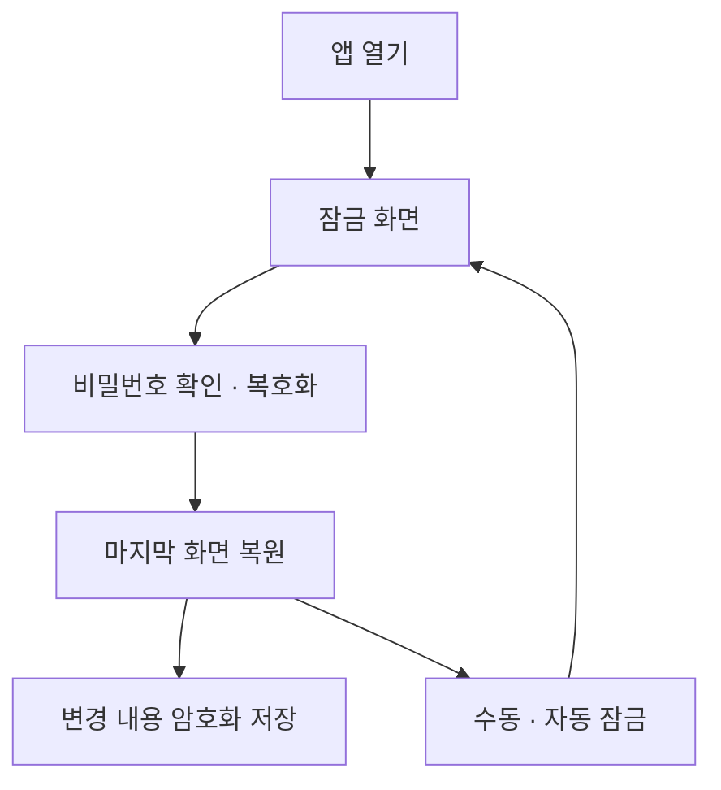

# 개인용 보험 DB 보안설계서

작성일: 2026-11-09 (한국시간)
문서 상태: 설계 문서. 앱 구현·보안 감사·실제 보험금 계산을 완료했다는 뜻이 아니다.
정리 범위: 이 대화에서 갑상선암 검색 예시부터 단일 HTML·로그인 추후 추가 결정 및 문서화 요청까지의 요구·설명·구조·보안 대응. 다른 대화·기존 첨부 보험자료의 전문이나 기존 DB 파일을 재분석한 결과는 아니다.
근거 구분: 사용자 요구는 이 대화를 출처로 하며, 기술 근거는 통합지침서의 출처 목록을 참고한다. 이 문서에 실제 계약·약관 조항이나 개인별 지급금액을 새로 확정하지 않는다.

## 1. 목표와 결정 상태

사용자는 타인이 업로드 자료를 열람하지 못하고 코드를 임의로 사용·수정하지 못하기를 원했다. 단일 HTML의 코드 열람·복사·수정을 완전히 차단하는 목표는 달성할 수 없으므로, 개인자료 보호를 별도 목표로 설계한다.

로그인·회원가입·서버·외부 서비스는 현재 범위에서 제외한다. 로그인은 추후 추가한다. 기기 내부 비밀번호 잠금은 로그인과 다른 기능으로 제안되었으며, 사용자는 잠금 비밀번호 자체의 사용 여부·자동 잠금 시간·복구 방식까지 별도로 확정하지 않았다. 개인정보 비공개 목표를 충족하는 기본 개발안은 로컬 잠금+암호화다. 잠금 없는 자동 열람과 타인의 동일 브라우저 열람 방지는 동시에 보장하지 않는다.

## 2. 보호 대상과 경계

보호 대상은 증권·약관 원본, 이름·주소·계약정보 등 개인정보, 질병검색·진단코드, 예상금액, 메모, 수정 이력, 임시 추출문·화면·백업이다. 공통 용어·일반 규칙과 민감정보를 구분한다.

일반적인 우발 열람과 저장 파일 유출에 대비한다. 잠금 해제 상태의 악성 코드·악성 확장·악성 OS·화면 촬영·물리적 메모리 추출까지 완전히 방어한다고 주장하지 않는다.

## 3. 위협과 대응

| ID | 위협 | 대응 |
|---|---|---|
| SEC-01 | 마지막 화면으로 타인 열람 | 앱 시작 시 잠금, 해제 후 복원, 수동·자동 잠금 |
| SEC-02 | IndexedDB 개인정보 평문 열람 | 원본·추출·검색·이력·화면 상태 암호화 |
| SEC-03 | PDF·백업·추출 문자열의 악성 코드 | 형식·크기·구조 검증, 텍스트 표시, 실행 금지 |
| SEC-04 | 외부 OCR·AI·라이브러리를 통한 전송 | 현재 네트워크 처리 없음, 라이브러리·폰트·OCR 자산 내장 |
| SEC-05 | 백업·PDF·CSV 유출 | 암호화 백업, 일반 내보내기 정보 선택 및 별도 확인 |
| SEC-06 | 삭제 후 사본 잔존 | 앱 원본·연결·이력 삭제 범위 안내, 외부 사본 별도 관리 |
| SEC-07 | 변조·잘못된 복원 | 인증된 암호화, 스키마·참조 검증, 미리보기·트랜잭션 |
| SEC-08 | 용량 부족·데이터 삭제 | 저장 오류 표시, 용량 확인, 백업·복원 검증 |
| SEC-09 | HTML 자체가 변조됨 | 신뢰하는 원본 사용, 개인자료와 분리, 배포본 버전·해시 확인 보조 |
| SEC-10 | 비밀번호·키 노출 | 원문 저장 금지, 암호화 키 영구 저장 금지, 잠금 시 참조 정리 |
| SEC-11 | 로그·파일명 노출 | 민감 로그 금지, 비민감 오류코드, 백업 파일명에 개인정보 배제 |
| SEC-12 | 공유 기기·확장 프로그램 | OS 계정 잠금·디스크 암호화·확장 관리 권장 |

IndexedDB는 저장 수단이며 앱 인증·암호화를 대신하지 않는다 [S1]. 동일 출처 코드의 접근 위험도 고려한다.

## 4. 암호화 구현 제안

검증된 브라우저 Web Crypto를 사용한다. AES-GCM 등 인증된 암호화와 비밀번호 기반 키 유도 방식을 조합하는 안을 검토한다. salt는 무작위 생성하고 암호화마다 IV 재사용을 방지한다. 키 유도 비용·암호문 구조·파일 단위 처리는 지원 기기에서 성능과 보안을 확인한 후 확정한다. salt·IV·알고리즘 버전은 비밀값이 아니지만 암호문과 함께 정확히 관리해야 한다.

비밀번호·복호화 키는 localStorage·IndexedDB·HTML·백업에 평문 저장하지 않는다. 모든 앱 실행에 같은 내장 키를 쓰는 방식도 금지한다. 화면 잠금만으로 보호 완료라 하지 않는다. Web Crypto는 사용 오류 위험이 있는 저수준 API이며 안전한 구현 검토가 필요하다 [S3].

## 5. 잠금과 화면 복원

잠금 상태에서는 보험명·질병명·금액·원본 미리보기·검색 결과를 숨긴다. DOM·미리보기 URL·추출 작업·복호화 데이터와 키 참조를 가능한 범위에서 정리한다. JavaScript에서 메모리 완전 삭제를 보장하지 않는다.

잠금 전에 저장 중 작업의 성공 여부를 처리하되 민감 화면은 즉시 숨긴다. 닫기 이벤트만 의존하지 않고 변경 시 저장한다. 자동 잠금 시간은 사용자 설정으로 두는 제안이며 구체값 미정이다.

## 6. 등록과 외부 통신

PDF 암호 입력과 앱 잠금을 분리한다. 원본에 불필요한 주민번호·주소 등이 있으면 등록 전 마스킹을 돕는다. 마스킹 표시만 덮어씌우는 방식은 실제 정보 제거 여부를 별도로 확인해야 한다.

외부 AI·OCR·분석·광고·원격 폰트·원격 스크립트를 현재 버전에 포함하지 않는다. 필요한 PDF·OCR 실행 자산은 HTML 내부에 포함하거나 해당 자동 기능을 지원 불가로 표시한다. 온라인 접속을 몰래 요구하지 않는다.

파일명·MIME·서명·크기·페이지 수·내용 구조를 검사하고 과도한 자원 소비를 제한한다. 업로드 텍스트를 innerHTML·eval 등으로 실행하지 않는다. PDF 미리보기의 스크립트·원격 링크 기능을 제한한다.

## 7. 백업·삭제·복원

백업은 원본 포함 전체 또는 일반 범위를 선택하고 암호화한다. 내보내기 비밀번호·버전·무결성 정보를 관리한다. 다른 비밀번호 백업도 가능한지 UI에 명시한다. 일반 PDF·CSV는 별도 평문 산출물일 수 있으므로 포함 정보를 검토한다.

복원은 암호 해제·인증 성공 후 구조·버전·참조 관계를 검증하고 합치기 또는 전체 교체 미리보기를 제공한다. 오류면 기존 DB를 변경하지 않는다. 데이터 삭제와 저장장치 포렌식상 완전 소거는 다르며, 내려받은 파일·클라우드 사본은 앱이 지울 수 없다.

## 8. 비밀번호 분실·변경

원문 비밀번호를 알려주는 기능이나 서버 복구는 없다. 복구코드·복구키를 도입할지는 미정이다. 도입 시 별도 보관하고 자체 위험을 안내한다. 복구 수단이 없으면 비밀번호 분실 시 복호화 불가다. 비밀번호 변경·재암호화는 중단·오류에도 기존 암호문을 보존하도록 설계한다.

## 9. 코드 보호와 함수화

함수화는 개발 구조를 나누는 방법이지 접근통제가 아니다. 우클릭 금지·개발자도구 차단·난독화는 코드 복사·수정의 확실한 방지 수단이 아니다. HTML을 받은 사람은 수정할 수 있다. 수정 HTML로 사용자가 비밀번호를 입력하도록 유도하는 공격도 고려한다. 해시는 신뢰하는 별도 기준과 비교할 때만 변조 확인의 보조 수단이다.

현재 목표는 ‘코드를 알아도 잠긴 개인자료를 비밀번호 없이 쉽게 읽지 못하게 하는 것’이며 절대 보안을 약속하지 않는다.

## 10. 환경 검증

file:// 직접 실행 환경에서 IndexedDB·Web Crypto·내장 PDF·OCR·Worker가 작동하는지 브라우저·기기별 검증한다. 지원이 안 되면 평문으로 자동 전환하지 않는다. HTML 경로·파일명 변경이나 브라우저별 저장소 분리도 테스트한다. 같은 브라우저라는 조건만으로 영구 보존을 보장하지 않는다 [S2].

## 11. 보안 완료 기준

- 브라우저 저장소 검사에서 민감 원문·비밀번호·키가 평문으로 나오지 않는다.
- 잠금 전후 화면·DOM·미리보기·새 탭 행동을 점검한다.
- 잘못된 비밀번호·변조 백업은 실패하며 기존 자료가 보존된다.
- 네트워크 연결을 끈 상태에서 핵심 기능이 동작하고 외부 요청이 없다.
- 악성 문자열은 텍스트로 표시되고 코드가 실행되지 않는다.
- 저장 실패·삭제·복원·비밀번호 변경 중 중단을 검증한다.
- 새 실행 시 잠금 해제 뒤 마지막 화면이 복원된다.

