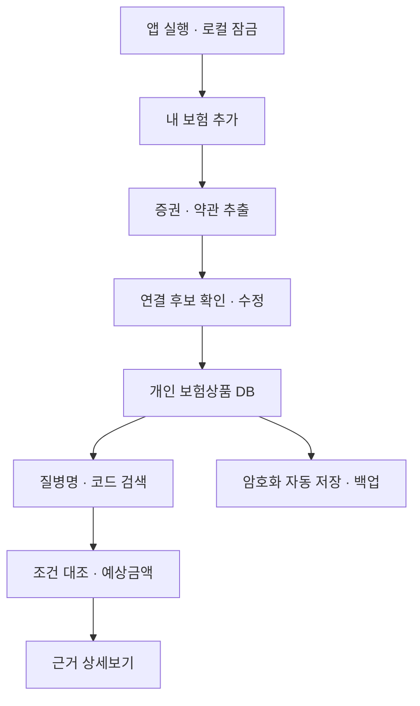

# 개인용 보험상품 통합 DB 개발계획서

작성일: 2026-11-09 (한국시간)
문서 상태: 설계 문서. 앱 구현·보안 감사·실제 보험금 계산을 완료했다는 뜻이 아니다.
정리 범위: 이 대화에서 갑상선암 검색 예시부터 단일 HTML·로그인 추후 추가 결정 및 문서화 요청까지의 요구·설명·구조·보안 대응. 다른 대화·기존 첨부 보험자료의 전문이나 기존 DB 파일을 재분석한 결과는 아니다.
근거 구분: 사용자 요구는 이 대화를 출처로 하며, 기술 근거는 통합지침서의 출처 목록을 참고한다. 이 문서에 실제 계약·약관 조항이나 개인별 지급금액을 새로 확정하지 않는다.

## 1. 개발 목표

본인 전용 단일 HTML에서 증권·약관 등록, 보험사·상품·보장 정리, 약관 상세보기, 질병 검색·예상금액, 수정·삭제, 암호화 자동 저장·백업을 제공한다. 로그인은 추후 기능이다. 이 문서는 계획이며 개발 완료 파일이 아니다.

## 2. 전체 흐름

## 3. 개발 단계와 산출물

| 단계 | 개발 내용 | 완료 확인 |
|---|---|---|
| P0 | file:// 실행·Web Crypto·IndexedDB·용량·내장 자산 호환성 조사 | 지원 브라우저·기기와 불가 기능을 실제로 기록 |
| P1 | 계약·보장·자료·근거·공통 5종 DB 스키마 | 가상 계약 두 개가 분리되고 참조 관계가 유지됨 |
| P2 | 암호화 저장·로컬 잠금·백업·기초 복원 | 평문 노출 없음, 잘못된 비밀번호·변조 파일 안전 실패 |
| P3 | PDF·사진·스캔 등록, 추출·직접 입력·이어 추출 | 성공·실패 페이지 구분, 중복 추출 방지, 원문 근거 연결 |
| P4 | 보험사·상품·특약·약관 연결 및 수동 확인 | 비슷한 상품·다른 버전·미가입 특약 오연결 차단 |
| P5 | 보험 목록·보장 상세·원문·수정·삭제 | 새 보험 추가 후 기존 계약 유지, 공유 근거 보존 |
| P6 | 질병코드·용어·조건·계산 엔진 | 가상 정액 계산 검증, 부족 정보는 계산 대기 |
| P7 | 마지막 화면·최근 검색·태그·이력 복구 | 잠금 해제 후 화면 복원, 검색 초기화 범위 정확 |
| P8 | 전체·일반 백업·합치기·교체·다른 기기 복원 | 원본·연결·이력·계산 근거 왕복 보존 |
| P9 | PC·모바일·오프라인·보안·대용량 종합 검증 | 외부 요청 없이 핵심 흐름 통과, 실패 상태 안내 |
| 후속 | 로그인·서버·동기화·AI 추가 | 현재 범위와 분리해 보안·동의·키 관리 재설계 |

## 4. 단일 HTML 구현 원칙

CSS·JavaScript·필수 라이브러리·글꼴·공통 DB·필요 OCR 모델 등을 HTML에 내장한다. 개발 과정의 소스는 나눌 수 있지만 최종 사용 산출물은 HTML 하나다. 개인자료는 HTML에 넣지 않고 브라우저에 저장한다. 백업·일반 내보내기 파일은 사용자가 별도로 생성하는 데이터 산출물이다.

다운로드형 CDN·외부 Worker·API·서버를 요구하면 현재 조건을 충족하지 못한다. 내장 OCR로 HTML이 커지거나 모바일 메모리가 부족할 수 있으므로 크기·성능을 측정한다. 자동 추출이 불가능한 파일은 직접 입력으로 처리하되 그 한계를 표시한다. 서버를 쓰는 방식으로 임의 변경하지 않는다.

## 5. 화면과 상태

- 첫 실행: 개인정보 저장 방식 → 로컬 잠금 방식 설정안 → 내 보험 추가.
- 재실행: 잠금 → 해제 → 마지막 화면 복원.
- 보험 추가: 다중 파일 등록 → 파일별 추출 상태 → 상품 연결 → 보장 확인 → 저장.
- 보험 조회: 보험사·상품·계약·보장 필터 → 상세 원본·약관.
- 질병 검색: 후보 코드 선택 → 추가 조건 입력 → 계약별 결과 → 계산 근거.
- 관리: 수정·삭제·변경 이력·검색 초기화·백업·복원.
- 저장 상태: 미저장·저장 중·저장 완료·저장 실패를 구별.
- 오류 상태: 추출 실패·약관 불일치·코드 미확인·공간 부족·잘못된 비밀번호·복원 불가.

## 6. 개발 구조 제안

하나의 HTML 내부에서도 자료입력, 추출, 정규화, 연결, 질병검색, 조건평가, 금액계산, 근거표시, 암호화, 저장, 백업·복원, 화면상태를 함수·모듈 단위로 나눈다. 함수화는 유지보수 목적이며 보안 장벽이 아니다.

데이터 접근 계층은 현재 IndexedDB에만 연결한다. 후속 로그인 기능을 위해 교체 가능한 인터페이스를 둘 수 있으나 서버 코드나 의존성을 미리 넣지 않는다.

## 7. 실제로 실행할 검증 사례

1. 가상 증권·약관을 넣으면 가입한 보장만 생성된다.
2. 다른 버전 약관이면 불일치·확인 필요로 표시된다.
3. 동일 보험사·동일 상품의 별도 계약이 각각 보존된다.
4. 새 계약 추가 후 기존 보장·근거·검색 정보가 유지된다.
5. 갑상선암 가상 예시의 200+500만 원은 조건 충족 시만 700만 원으로 나온다.
6. 수술 여부·실손 지출이 없으면 그 금액은 계산 대기다.
7. 근거 조항 상세보기에서 원본 페이지가 맞는다.
8. 수정된 조건은 계산·이력에 반영되며 이전 결과는 사용 버전을 보존한다.
9. 잠금·재실행 후 민감 화면은 해제 전 표시되지 않는다.
10. 암호화 백업을 다른 브라우저에서 복원하면 자료·연결·이력이 유지된다.
11. 변조·손상·구버전 백업은 검증 후 안전하게 처리하며 기존 DB를 훼손하지 않는다.
12. 삭제 시 다른 계약과 공유 약관 연결은 유지된다.
13. 저장공간 부족이면 저장 완료 표시를 하지 않는다.
14. 인터넷 차단·시크릿창·HTML 이동·파일명 변경을 시험하고 지원 범위를 기록한다.
15. 악성 문자열·큰 파일·중단된 추출에 앱이 안전하게 대응한다.

## 8. 미정·검증 필요 사항

로컬 비밀번호 잠금 도입의 최종 확인, 자동 잠금 시간, 복구키 제공 여부, 암호화 파라미터, 지원 브라우저·기기, OCR 내장 범위·HTML 크기, 질병코드 데이터 버전·이용조건, 삭제·이력 보존 정책, 기존 평문 DB를 암호화하는 이전 절차가 남아 있다.

브라우저에서 file:// 저장·암호화가 불안정한 환경은 실제 시험 전 지원된다고 단정하지 않는다. 백업 없는 데이터 영구 보존을 약속하지 않는다.

