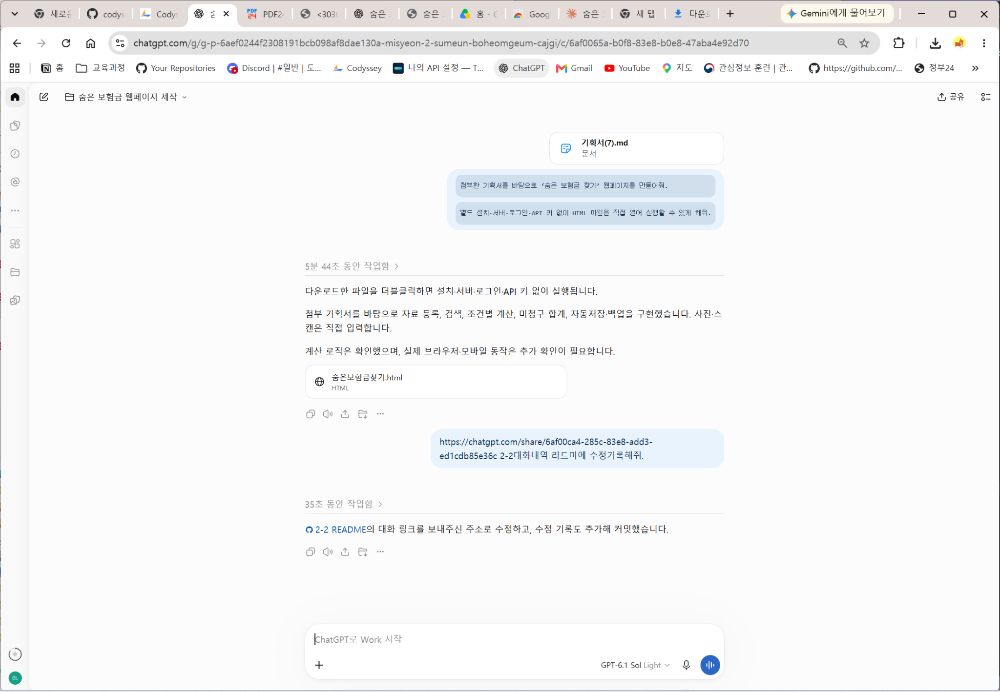
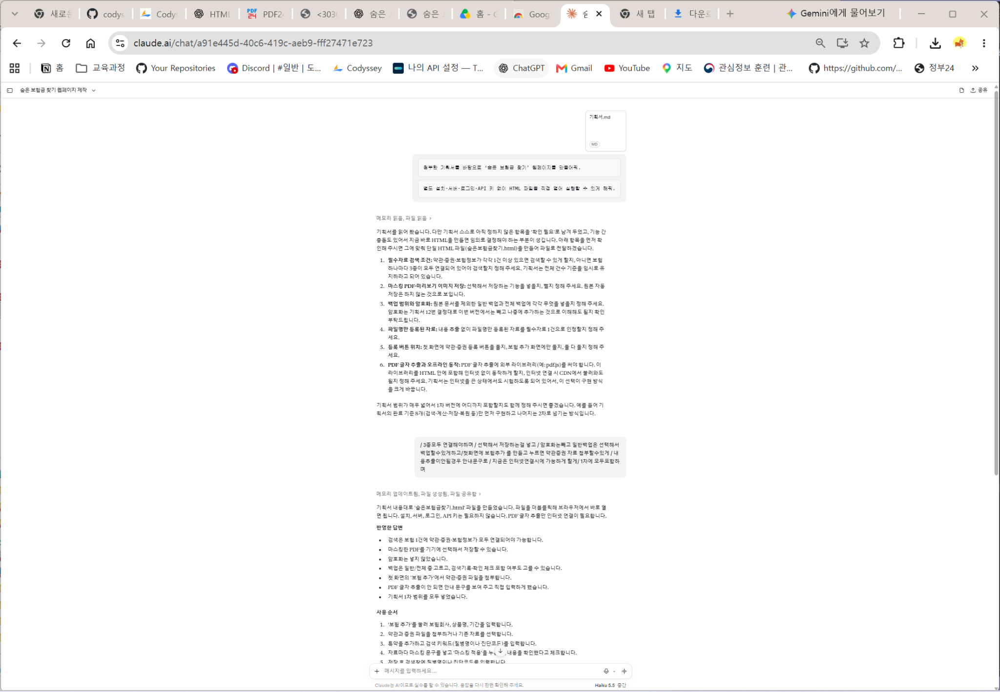
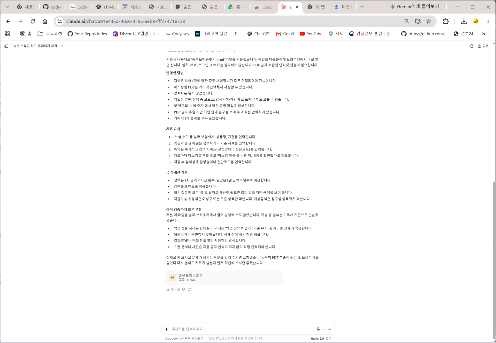

# 미션 2-2 · 두 AI로 HTML 만들고 테스트하기

같은 기획서와 요청으로 만든 두 AI의 HTML을 비교하고 하나를 선택한 뒤, 선택한 HTML의 테스트 3건을 기록합니다.

## 파일 구성

| 파일·폴더 | 용도 | 현재 상태 |
| --- | --- | --- |
| [숨은보험금찾기_v1.html](./숨은보험금찾기_v1.html) | 선택한 ChatGPT HTML | 첨부 원본의 내용을 수정하지 않고 등록 |
| [제작검증기록.md](./제작검증기록.md) | 두 AI 비교·선택 근거·테스트 3건 | 양식 구성, 비교·테스트 결과 작성 대기 |
| [캡처](./캡처) | 비교 및 테스트 증거 이미지 | 업로드 대기 |
| [미션 2-1 기획서.md](../미션%202-1/기획서.md) | 평가 참고 자료 | 기존 기획서 연결 |

## 선택한 결과물

- ChatGPT 결과물을 선택했습니다.
- 선택 근거: 기획서를 그대로 반영한 것 같아서 선택했습니다.
- 모델명은 첨부 파일명만으로 확정하지 않고, 실제 사용 화면을 확인한 후 기록합니다.
- 선택하지 않은 Claude HTML은 제출 파일에 포함하지 않고 설명 또는 캡처로 비교 내용을 남깁니다.

## 앞으로 기록할 내용

1. 두 AI에 실제 전달한 동일 요청과 정확한 서비스·모델 이름을 확인합니다.
2. 두 HTML에 같은 작업을 수행하고 비교표를 작성합니다.
3. 선택한 HTML의 테스트 3건을 수행하고 테스트 내용·예상 결과·실제 결과를 기록합니다.
4. 최소 1건은 좁은 화면, 빈 입력값, 인쇄 등 조건을 바꿔 테스트합니다.
5. 캡처를 해당 폴더에 추가하고 제작검증기록에 연결합니다.
6. 캡처와 관찰 내용을 바탕으로 제작검증기록·README의 진행 기록을 갱신합니다.

예상과 다른 결과도 관찰한 대로 기록하며, HTML 수정은 다음 미션에서 진행합니다.

## 진행 기록

| 날짜 | 내용 |
| --- | --- |
| 2026-11-08 | 미션 2-2의 이전 HTML을 삭제하고 README를 새로 작성했다. 선택한 ChatGPT HTML을 v1으로 등록하고 제작검증기록·캡처 폴더를 구성했다. 테스트 결과는 비워 두었다. |
| 2026-11-08 | 첨부한 Claude 초안 HTML을 선택하지 않은 비교 자료로 README에 연결했다. |

## 첨부한 비교 자료

- [클로드haiku5.5 초안 숨은보험금찾기(1).html](https://chatgpt.com/library?file_id=libfile_d1d71889c54c81919464b730e61c16f9&account_id=personal)
- Claude로 제작한 비교용 HTML 첨부파일입니다. 파일명에 표기된 모델명은 `haiku5.5`이며, 정확한 모델명은 실제 사용 화면을 확인한 후 기록합니다.
- 최종 선택은 ChatGPT 결과물입니다. Claude 결과의 비교 설명과 화면 캡처는 테스트 후 제작검증기록에 추가합니다.
- 미션 제출 시 선택한 HTML 1개만 제출하며, 위 첨부 링크는 비교 원본을 확인하기 위한 참고 자료입니다.

## AI와의 대화 기록

- [숨은 보험금 찾기 HTML 제작 대화](https://chatgpt.com/share/6af00ca4-285c-83e8-add3-ed1cdb85e36c)
- 첨부한 기획서를 바탕으로 별도 설치·서버·로그인·API 키 없이 실행하는 HTML 제작을 요청한 대화입니다.

## ChatGPT 테스트 캡처 기록

- 자료 등록 화면: 등록·수정 창과 입력 항목을 확인했습니다. 파일 등록 완료·자동 추출 성공 여부는 미확인입니다.
- 화상 검색 결과: 관련 보장 1건, 금액 산정 불가, 추가 확인 1건, 합계 0원 표시를 확인했습니다.
- [제작검증기록의 테스트 1·2](./제작검증기록.md)에 캡처를 연결했습니다. 테스트 3과 Claude 비교 결과는 빈칸으로 유지합니다.
- 캡처의 실행 파일명과 제출 예정 v1 파일의 내용 일치 여부는 확인이 필요합니다.

## 최초 HTML 제작 요청

- [처음 HTML 제작을 요청한 ChatGPT 대화](https://chatgpt.com/share/6af012d3-a718-83ec-a295-4b7124e71486)
- 사용자가 최초 제작 요청 대화로 확인해 준 링크입니다. 기존 대화 링크와 구분해 기록합니다.
- 첨부 기획서: `기획서(7).md` (캡처 표기)
- 화면에 표시된 모델명: `GPT-6.1 Sol Light` (캡처 시점의 표시이며, 최초 생성 당시 모델과 동일한지는 별도 확인 필요)

## Claude HTML 제작 요청 기록

- [Claude HTML 제작 요청 대화](https://claude.ai/share/5c0ba5a2-159a-4dd3-b8d8-bd2afef96796)
- 첨부 기획서 이름: `기획서.md` (캡처 표기).
- 화면 모델 표시: `Haiku 5.5 중간` (캡처 표기).
- 최초 요청 문구는 ChatGPT에 전달한 두 문장과 동일한 것으로 캡처에서 확인했습니다. 첨부 기획서의 파일명은 다르며 내용이 동일한지는 별도 확인이 필요합니다.
- Claude가 추가 질문을 했고 사용자가 검색 조건, 선택 저장, 암호화 제외, 백업 선택, 등록 버튼 위치, 인터넷 연결 시 PDF 추출 허용, 1차 범위 전체 구현에 답변했습니다.
- 따라서 ‘한쪽 AI에만 추가 요청을 전달하지 않는다’는 미션 조건과 차이가 있습니다. 최초 요청의 동일성과 이후 추가 답변을 구분해 기록하며, 두 AI의 전체 제작 조건이 같았다고 단정하지 않습니다.
- Claude 답변에는 되돌리기 미구현, 백업 충돌 처리 단순화, PDF 글자 추출 시 인터넷 필요, 실제 브라우저 미검증이 명시되어 있습니다. 이는 AI의 제작 설명이며 사용자의 실제 동작 테스트 결과와 구분합니다.

