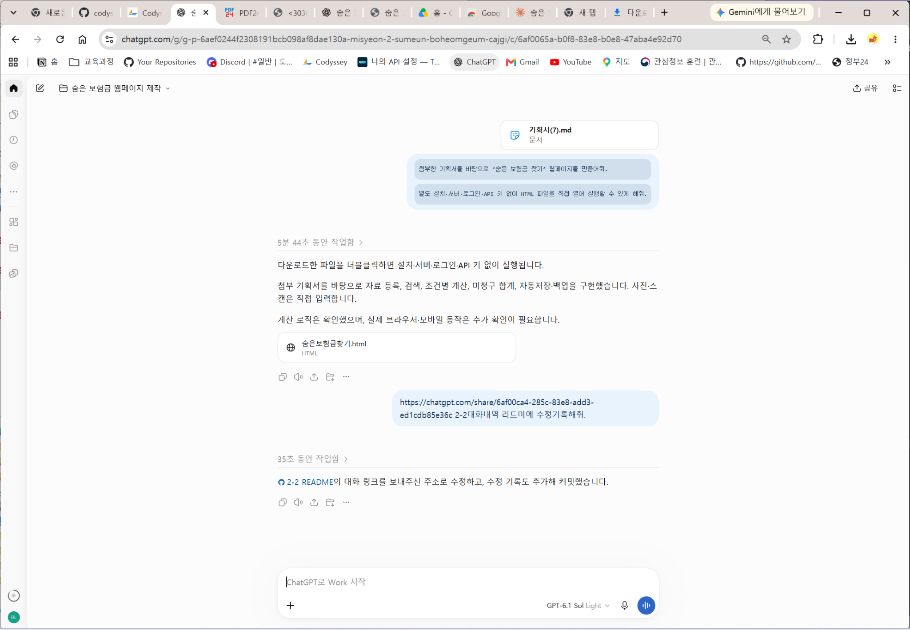
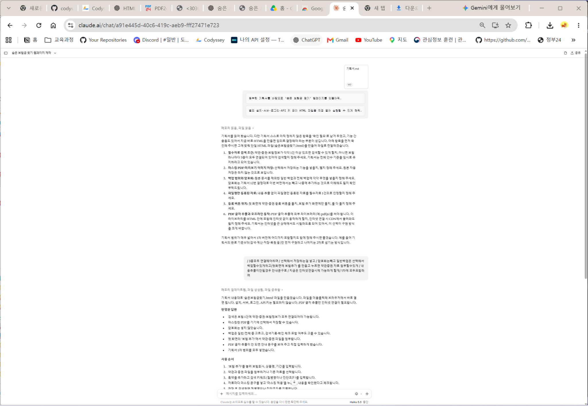
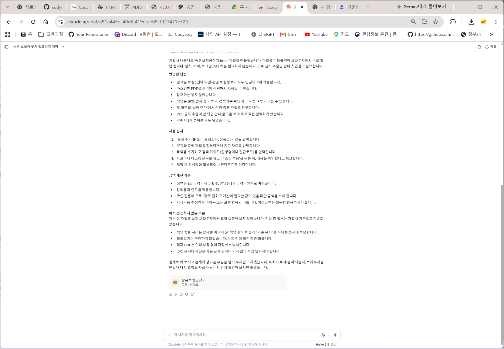

# 제작·검증 기록: 숨은 보험금 찾기

## 두 AI 비교
- AI A : ChatGPT (sol 6.1)  (첨부 파일명 표기: 숨은보험금찾기_v1.html)
- AI B : Claude (haiku5.5) (첨부 파일명 표기: 클로드haiku5.5 초안 숨은보험금찾기.html)
- 동일한 기획서와 함께 전달한 요청:

  ChatGPT에 전달한 요청 (사용자 제공 캡처에서 확인):

  > 첨부한 기획서를 바탕으로 ‘숨은 보험금 찾기’ 웹페이지를 만들어줘.
  >
  > 별도 설치·서버·로그인·API 키 없이 HTML 파일을 직접 열어 실행할 수 있게 해줘.

  Claude 최초 요청도 같은 두 문장임을 제공된 캡처에서 확인했습니다. 이후 Claude에만 추가 질문에 대한 답변을 전달했습니다.

- [처음 HTML 제작을 요청한 ChatGPT 대화](https://chatgpt.com/share/6af012d3-a718-83ec-a295-4b7124e71486)
- 제작 요청 시 첨부한 기획서: `기획서(7).md` (캡처 표기). 미션 2-1 기획서와의 내용 일치 여부는 미확인입니다.
- 캡처 하단 모델 표시: `GPT-6.1 Sol Light`. 최초 생성 당시 모델을 증명하는지는 미확인입니다.

- 참고 기획서: [미션 2-1 기획서](../미션%202-1/기획서.md)
- 동일한 기획서·요청 전달 여부: 최초 요청 문구는 동일. 기획서 내용 일치 여부는 미확인. Claude에만 추가 답변 전달 (하단 기록 참고)
- 비교 및 테스트 상태: 사용자가 제공한 ChatGPT 캡처 2건을 기록했습니다. Claude 비교와 조건 변경 테스트는 대기 중입니다.

| 테스트 내용 | AI A | AI B |
| --- | --- | --- |
| 보험약관 등록 화면 | 파일 선택·문서 제목·버전·태그·수동 입력 항목이 보임. 등록 완료 여부는 미확인 |  |
| 화상 검색 | 관련 보장 1건, 금액 산정 불가, 추가 확인 1건이 표시됨 |  |
|  |  |  |

- 선택한 결과물: [숨은보험금찾기_v1.html](./숨은보험금찾기_v1.html) (ChatGPT)
- 선택 근거: 기획서를 그대로 반영한 것 같아서 ChatGPT 결과물을 선택했다.
- 선택하지 않은 Claude 결과: 아래에 설명 또는 화면 캡처를 추가할 예정입니다.

### 비교 화면 캡처

<!-- 캡처/비교 폴더에 이미지를 등록한 후 상대 경로로 연결합니다. -->

## 테스트 기록
| 번호 | 테스트 내용 | 예상 결과 | 실제 결과 |
| --- | --- | --- | --- |
| 1 | 보험약관 등록 화면 확인 | 파일 선택과 문서 내용을 확인·입력하는 화면이 표시된다. | 보험약관 등록·수정 창에 파일 선택, 문서 제목, 버전·적용일, 태그, 1페이지 수동 입력, 수동 페이지 추가 항목이 보인다. 선택된 파일과 입력 내용은 없으며, 저장·등록 완료와 PDF 자동 추출 성공은 이 캡처로 확인할 수 없다. |
| 2 | 가상 검색: 화상 입력, 질병 태그 선택 상태의 결과 확인 | 관련 보장과 금액 계산 가능 여부가 표시된다. | 화상 관련 보장 1건과 농협가성비굿플러스어린이보험이 표시된다. 자료 부족·추가 확인 및 금액 산정 불가가 보이고, 지급가능 추정액·예상금액·미청구 금액은 모두 0원, 추가 확인은 1건이다. 이는 지급 대상이 없다는 확정이나 계산 성공을 뜻하지 않는다. |
| 3 (좁은 화면·빈칸 입력·인쇄 등 조건을 바꿔 테스트) |  |  |  |

### 테스트별 화면 캡처

#### 테스트 1 · 자료 등록 화면

- 테스트 1 캡처: 자료 등록 화면
#### 테스트 2 · 화상 검색 결과

- 테스트 2 캡처: 화상 검색 결과
- 테스트 3 캡처:
- 실행 환경: Windows PC · Chrome · 로컬 HTML 직접 실행. 화면 너비는 미기록.
- 캡처 주소 표시줄의 실행 파일명은 `챗지피티 초안 숨은보험금찾기.html`입니다. 제출 예정인 `숨은보험금찾기_v1.html`과 동일한 내용인지 사용자 확인이 필요합니다.
- 예상 결과는 기록 정리를 위한 확인 기준이며, 실제 결과는 제공된 캡처에서 관찰한 범위만 작성했습니다.
- 테스트 3은 아직 수행·기록하지 않았으며, 좁은 화면·빈 입력값·인쇄 등 조건 변경 테스트가 필요합니다.

## 수정 기록

아래 수정 기록과 사용자 테스트는 다음 미션에서 활용할 양식이며, 이번 미션에서는 비워 둡니다.

### 수정 기록 1
- 발견한 문제:
- AI에게 전달한 요청:
- 수정 후 테스트 결과:
- 수정 이유:

### 수정 기록 2
- 발견한 문제:
- AI에게 전달한 요청:
- 수정 후 테스트 결과:
- 수정 이유:

### 수정 기록 3
- 발견한 문제:
- AI에게 전달한 요청:
- 수정 후 테스트 결과:
- 수정 이유:

## 사용자 테스트
- 테스트 참여자와 요청한 작업:
- 사용자의 행동과 질문:
- 받은 피드백:
- 반영 내용과 결과:

## Claude HTML 제작 요청 기록

- [Claude HTML 제작 요청 대화](https://claude.ai/share/5c0ba5a2-159a-4dd3-b8d8-bd2afef96796)
- 첨부 기획서 이름: `기획서.md` (캡처 표기).
- 화면 모델 표시: `Haiku 5.5 중간` (캡처 표기).
- 최초 요청 문구는 ChatGPT에 전달한 두 문장과 동일한 것으로 캡처에서 확인했습니다. 첨부 기획서의 파일명은 다르며 내용이 동일한지는 별도 확인이 필요합니다.
- Claude가 추가 질문을 했고 사용자가 검색 조건, 선택 저장, 암호화 제외, 백업 선택, 등록 버튼 위치, 인터넷 연결 시 PDF 추출 허용, 1차 범위 전체 구현에 답변했습니다.
- 따라서 ‘한쪽 AI에만 추가 요청을 전달하지 않는다’는 미션 조건과 차이가 있습니다. 최초 요청의 동일성과 이후 추가 답변을 구분해 기록하며, 두 AI의 전체 제작 조건이 같았다고 단정하지 않습니다.
- Claude 답변에는 되돌리기 미구현, 백업 충돌 처리 단순화, PDF 글자 추출 시 인터넷 필요, 실제 브라우저 미검증이 명시되어 있습니다. 이는 AI의 제작 설명이며 사용자의 실제 동작 테스트 결과와 구분합니다.

