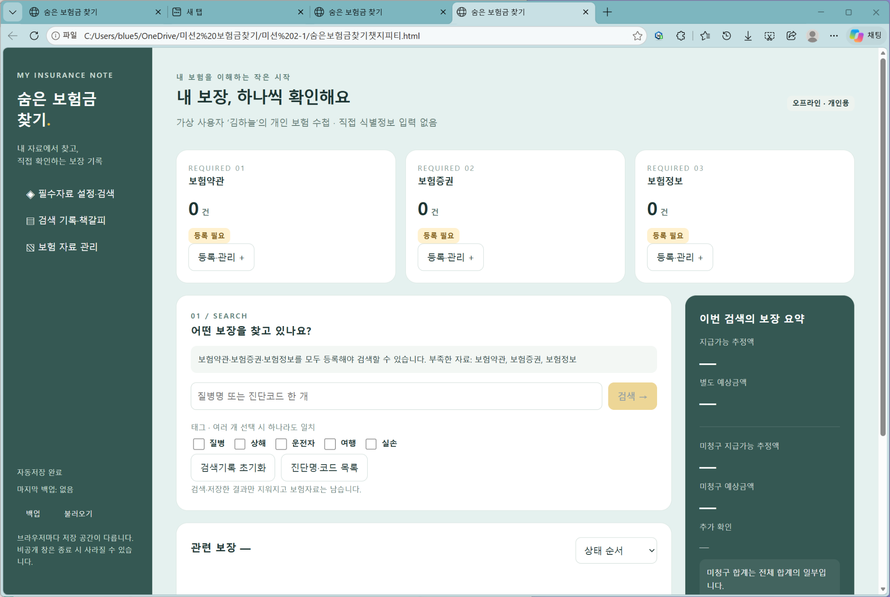
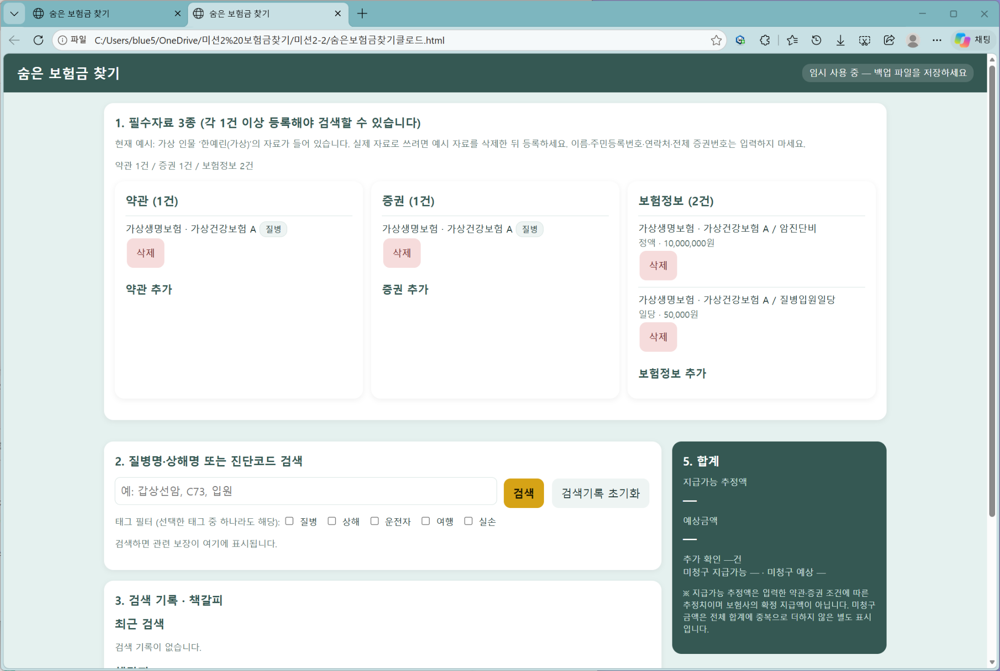

# HTML로 열어보기 비교

챗지피티와 클로드 결과물을 같은 테스트 항목으로 비교한 사용자 제공 화면 기록입니다.

## 화면에서 확인한 내용

챗지피티는 왼쪽 메뉴와 필수자료 3종의 등록 현황, 검색 영역이 표시됩니다. 클로드는 상단 제목 아래에 약관·증권·보험정보 카드와 검색 영역이 표시됩니다. 챗지피티 화면은 자료가 0건이며, 클로드 화면은 가상 예시 자료가 등록된 상태입니다.

## 비교 캡처

### 챗지피티_HTML열기

### 클로드_HTML열기

