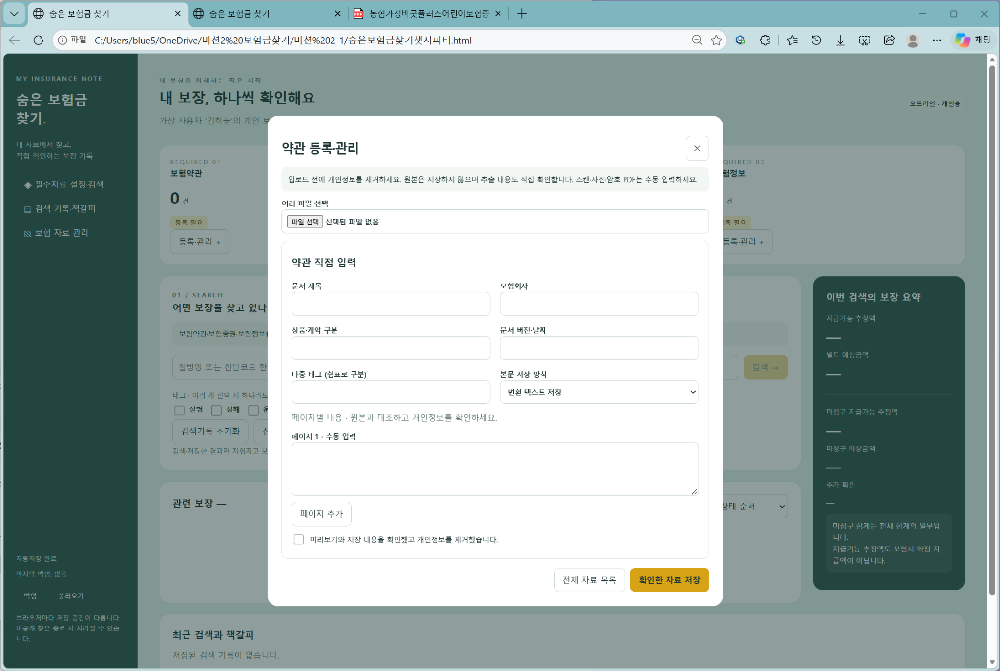
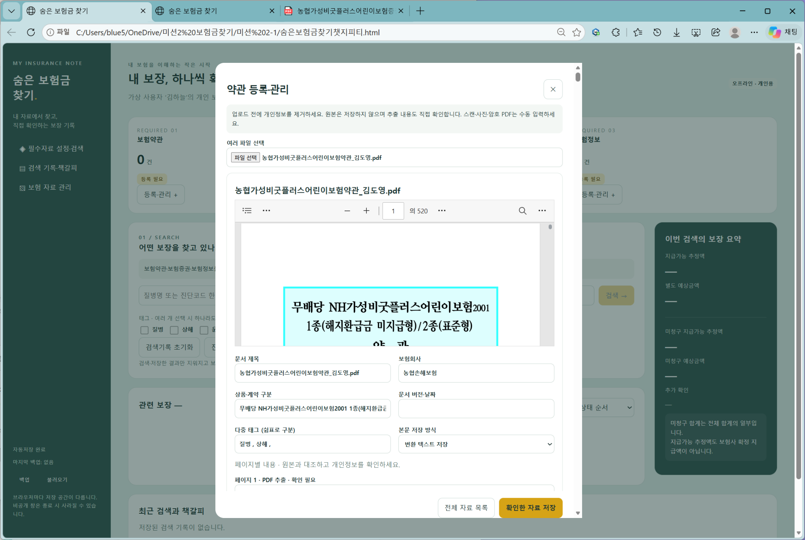
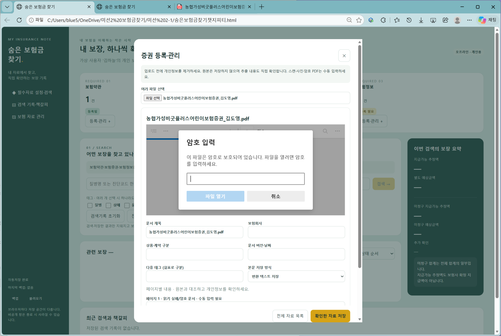
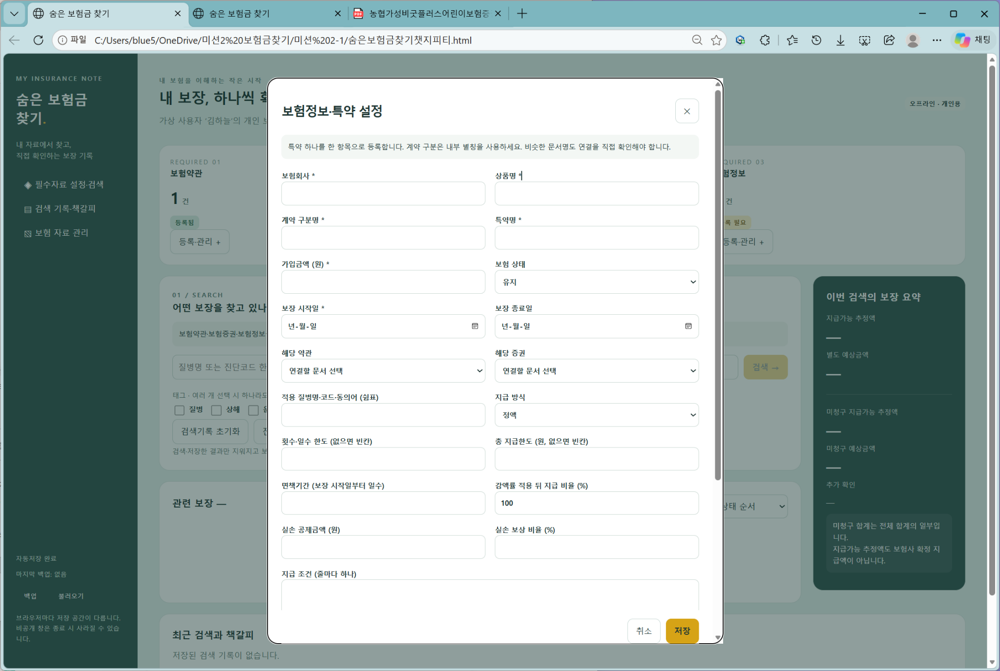
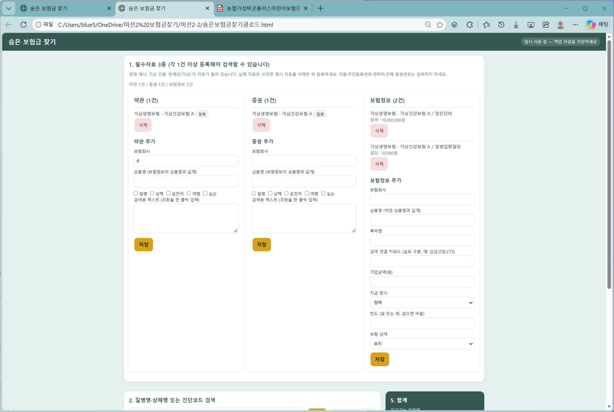

# 자료 등록해 보기 비교

챗지피티와 클로드 결과물을 같은 테스트 항목으로 비교한 사용자 제공 화면 기록입니다.

## 화면에서 확인한 내용

챗지피티는 약관 등록 창, PDF 미리보기와 추출 확인 항목, 암호가 있는 증권의 암호 입력 안내, 보험정보·특약 입력 창이 표시됩니다. 클로드는 약관·증권·보험정보를 화면에서 직접 입력하는 양식과 저장 버튼이 표시됩니다. 캡처만으로 모든 자료의 저장 완료나 추출 내용의 정확성까지 확인하지는 못했습니다.

## 비교 캡처

### 챗지피티_자료등록1

### 챗지피티_자료등록2

### 챗지피티_자료등록3

### 챗지피티_자료등록4

### 클로드_자료등록

