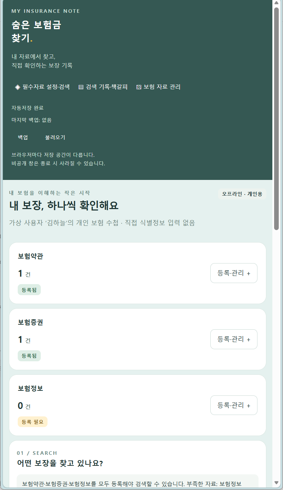
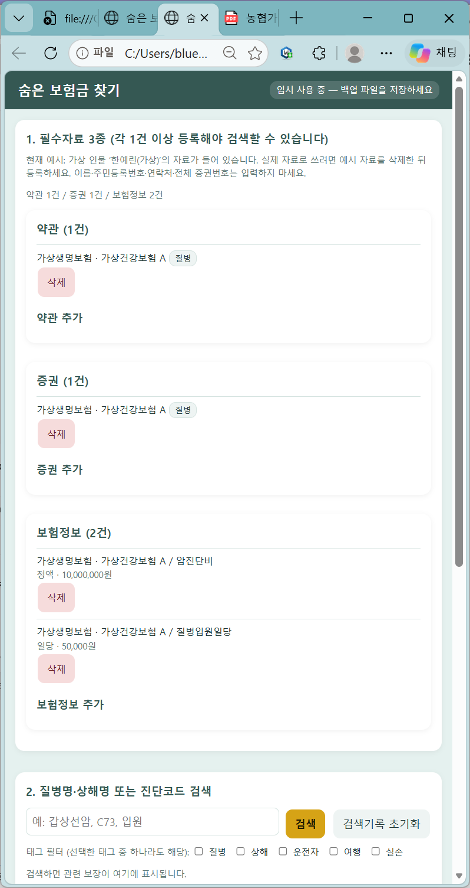

# 화면 줄여 보기 비교

챗지피티와 클로드 결과물을 같은 테스트 항목으로 비교한 사용자 제공 화면 기록입니다.

## 화면에서 확인한 내용

두 결과물 모두 좁은 화면에서 필수자료 카드가 세로로 배치됩니다. 챗지피티는 기존 왼쪽 메뉴가 상단에 배치되어 본문이 그 아래로 이어집니다. 클로드는 상단 제목 아래에 자료 카드가 세로로 이어지며, 아래쪽에 검색 입력란과 버튼이 표시됩니다. 이 기록은 브라우저 화면 폭을 줄인 캡처를 기준으로 합니다.

## 비교 캡처

### 챗지피티_좁은화면

### 클로드_좁은화면

