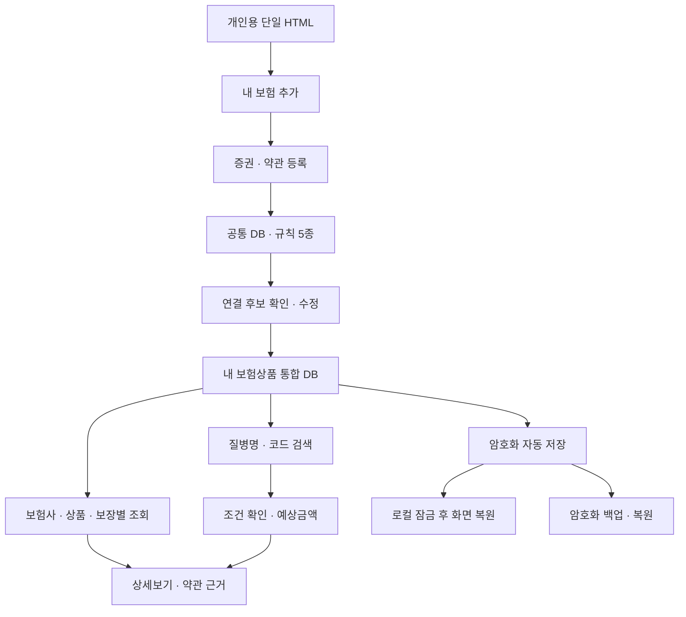
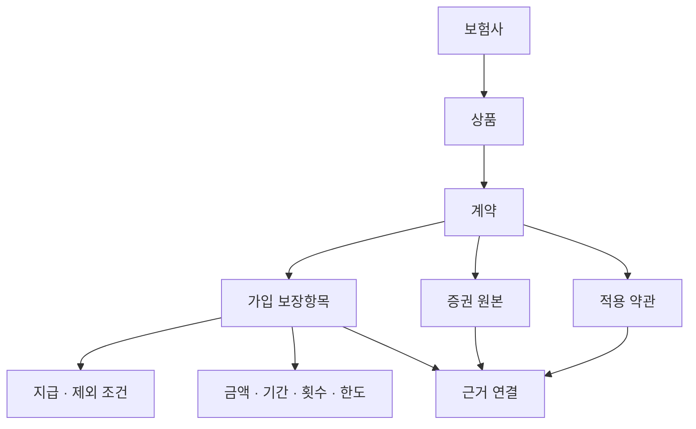
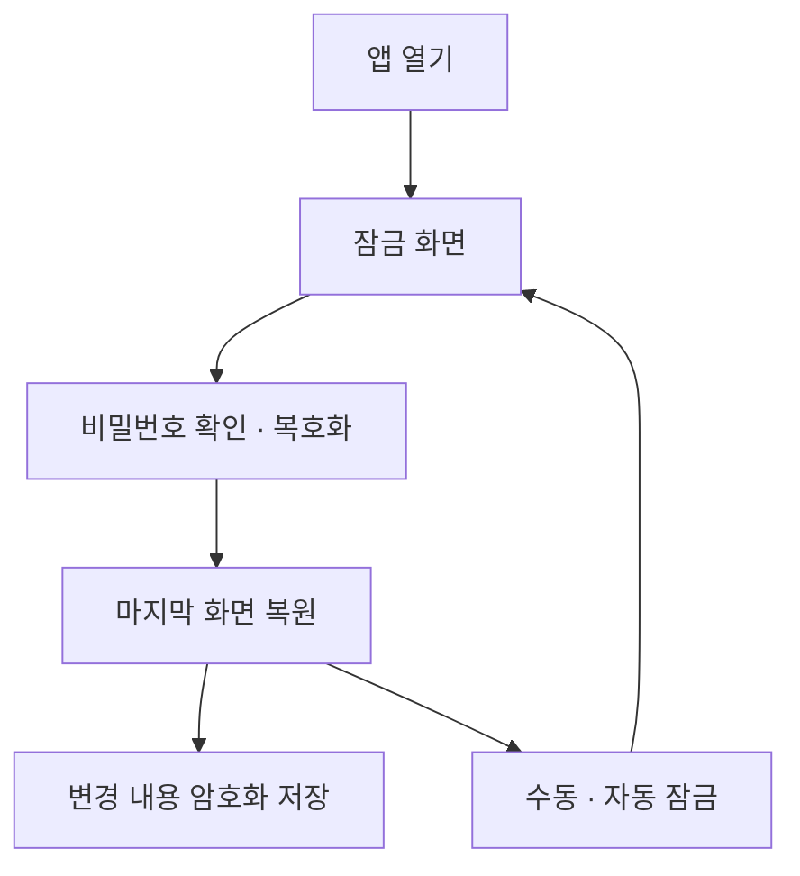
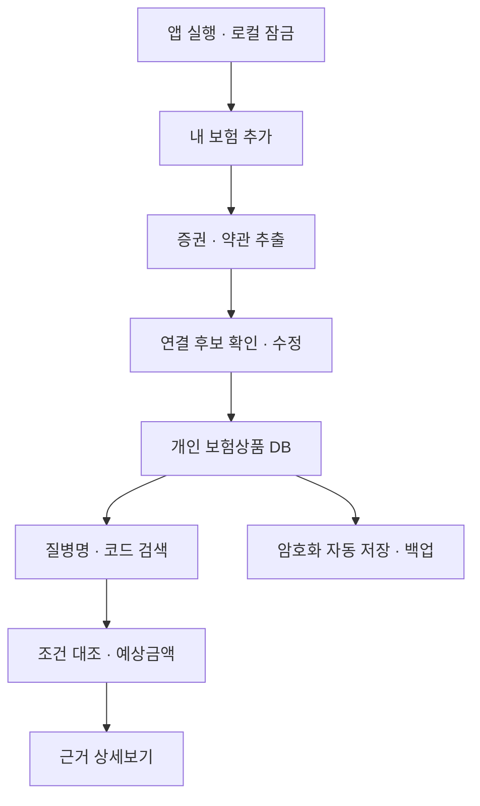

# 통합지침서

작성일: 2026-11-09 (한국시간)
문서 상태: 설계 문서. 앱 구현·보안 감사·실제 보험금 계산을 완료했다는 뜻이 아니다.
정리 범위: 이 대화에서 갑상선암 검색 예시부터 단일 HTML·로그인 추후 추가 결정 및 문서화 요청까지의 요구·설명·구조·보안 대응. 다른 대화·기존 첨부 보험자료의 전문이나 기존 DB 파일을 재분석한 결과는 아니다.
근거 구분: 사용자 요구는 이 대화를 출처로 하며, 기술 근거는 통합지침서의 출처 목록을 참고한다. 이 문서에 실제 계약·약관 조항이나 개인별 지급금액을 새로 확정하지 않는다.

## 문서 구성

1. 항목별 데이터베이스 설계서: 필수 5종과 개인 DB 필드·연결·근거 구조
2. 보안설계서: 위협·잠금·암호화·파일·백업·복구·코드 보호 한계
3. 규칙서: 등록·연결·계산·조회·저장·삭제·운영
4. 개발계획서: 단계·화면·검증·미정사항
5. 대화내용 및 요구사항 추적표: 사용자 발언과 반영 내역
6. 출처와 적용 범위

아래에는 분리 문서의 내용을 생략 없이 모두 수록했다. 중복되는 설명은 독립 문서의 의미를 보존하기 위해 유지했다.

## 전체 구조

## 최신 범위 요약

본인 전용. 로그인·서버·외부 서비스 없이 HTML 하나로 실행. 개인자료는 코드에 내장하지 않고 브라우저에 저장. 5종 공통 DB·규칙으로 상품을 연결. 신규 계약 추가·수정·삭제. 보험사·보장·금액·약관 근거 조회. 같은 브라우저 마지막 화면 복원. 타인 열람 방지를 위해 로컬 암호화·잠금 설계안을 제시. 로그인은 추후 추가. 코드 복사·수정 완전 차단은 보장할 수 없음.

---

<!-- 분리 문서: 01_항목별데이터베이스.md -->

# 항목별 데이터베이스 설계서

작성일: 2026-11-09 (한국시간)
문서 상태: 설계 문서. 앱 구현·보안 감사·실제 보험금 계산을 완료했다는 뜻이 아니다.
정리 범위: 이 대화에서 갑상선암 검색 예시부터 단일 HTML·로그인 추후 추가 결정 및 문서화 요청까지의 요구·설명·구조·보안 대응. 다른 대화·기존 첨부 보험자료의 전문이나 기존 DB 파일을 재분석한 결과는 아니다.
근거 구분: 사용자 요구는 이 대화를 출처로 하며, 기술 근거는 통합지침서의 출처 목록을 참고한다. 이 문서에 실제 계약·약관 조항이나 개인별 지급금액을 새로 확정하지 않는다.

## 1. 목적과 범위

본인 한 명만 사용하는 보험상품 통합 DB다. 본인이 등록한 증권과 약관을 보험사별·상품별·계약별·보장항목별로 연결한다. 질병명·진단코드를 입력하면 가입 보장과 대조하고 예상 지급금액 및 그 근거까지 열람한다. 국내 전체 상품을 무조건 포함한 DB나 보험사 지급결정을 대신하는 시스템으로 표현하지 않는다.

공통 연결 규칙·용어사전·질병코드 DB와 개인 보험상품 DB를 분리한다. 새 보험을 가입하면 ‘내 보험 추가하기’로 해당 증권·약관을 추가하고 기존 DB를 유지한다. 사용자 수정·삭제도 지원한다.

## 2. 반드시 필요한 5개 항목

| ID | DB·규칙 | 입력 | 출력·연결 |
|---|---|---|---|
| DB-01 | 약관·증권 → 내 보험정보 구성 규칙 | 증권·약관 원본과 추출 문장 | 보험사·상품·계약·가입 보장·가입금액 |
| DB-02 | 증권 ↔ 적용 약관 연결 규칙 | 상품 식별자·특약명·계약일·약관 버전 | 적용 가능한 약관·조항·근거 페이지 |
| DB-03 | 보험사별 언어 통합사전 | 회사·보장·특약·지급 표현 | 공통 개념·별칭·원문 표현 |
| DB-04 | 질병코드 DB | 질병명·유사 표현·진단코드 | 정식 명칭·후보 코드·분류 버전 |
| DB-05 | 질병코드 ↔ 내 보험정보 연결 규칙 | 코드·가입 특약·약관·사건 조건 | 보장 후보·조건 판정·예상금액·근거 |

## 3. 개인 DB의 관계

회사나 상품명이 같아도 계약을 합치지 않는다. 약관에 실린 특약 전체를 가입 보장으로 간주하지 않는다. 하나의 약관 원본을 여러 계약이 참조할 수 있으므로 원본과 연결을 별도 관리한다.

## 4. 데이터 구조 제안

다음은 구현 제안 필드이며 실제 채워진 DB는 아니다.

| 데이터 | 주요 필드 |
|---|---|
| 보험사 | insurerId, 원래 회사명, 표준 회사명, 별칭, 명칭 적용기간, 근거 |
| 상품 | productId, insurerId, 원문 상품명, 상품 식별정보, 판매·개정 시기 |
| 계약 | contractId, productId, 계약일, 보장개시·종료일, 상태, 증권 연결 |
| 자료 | documentId, 종류, 원래 파일명, 형식, 크기, 해시, 암호화 원본, 등록일 |
| 페이지 추출 | documentId, page, 추출 상태, 추출 문장, 추출 방법, 오류 |
| 보장 | coverageId, contractId, 원문 특약명, 표준 보장 개념, 가입금액·단위, 기간 |
| 약관 | termsId, documentId, 상품 식별정보, 버전, 적용기간, 확인 상태 |
| 조항 | clauseId, termsId, 조항·별표 제목, 페이지, 근거 문장 |
| 근거 연결 | evidenceId, 대상 ID, documentId, page, clauseId, 원문 구간, 확인 상태 |
| 지급 조건 | ruleId, coverageId, 질병 범위, 사건 유형, 날짜 조건, 지급식, 제외·횟수·한도 |
| 질병 | codeSystem, version, code, 정식 명칭, 상하위 코드, 별칭, 출처 |
| 검색·계산 | searchId, 입력, 선택 코드, 사건 조건, 계약별 결과, 계산식, 사용 규칙 버전 |
| 청구·메모 | 결과 연결, 미청구·청구함·모름, 메모·근거 |
| 수정 이력 | 대상 ID, 변경 전후, 변경일, 근거, 복구 가능 상태 |
| 화면 상태 | 경로, 선택 보험·보장, 필터, 최근 검색·탭·스크롤 위치 |
| 보안 메타데이터 | 스키마 버전, 암호화 방식·버전, salt, IV, KDF 설정, 암호문 |

계약번호 등 식별정보가 필요한 경우도 암호화한다. 원문 전체를 파일명·로그·검색 인덱스에 평문으로 중복 저장하지 않는다.

## 5. DB-01: 내 보험정보 구성

1. 증권과 약관을 등록하고 파일별 미리보기·마스킹 확인을 제공한다.
2. 브라우저 내부에서 텍스트를 추출한다. 스캔은 내장 OCR을 사용할 수 있는지 검증하고 실패하면 직접 입력을 지원한다.
3. 보험사·상품·가입시기·특약·가입금액·기간·단위를 후보로 추출한다.
4. 성공한 페이지와 실패한 페이지를 분리 저장한다. 재시작 시 완료 페이지를 중복 처리하지 않고 미완료 페이지를 이어서 처리하는 방식을 개발 검증 대상으로 둔다.
5. 사용자가 확인·수정한 뒤 계약과 가입 보장으로 저장한다.
6. 동일 파일은 해시로 후보 중복을 알리되, 동일 자료로 보인다고 다른 계약을 자동 병합하지 않는다.
7. PDF 파일 비밀번호는 앱 잠금 비밀번호와 다르며 사용자가 입력하고 원문 비밀번호를 저장하지 않는다.

## 6. DB-02: 증권과 약관 연결

보험사·상품명만으로 확정하지 않는다. 계약일·상품 버전·특약 원문명·특약 식별정보·약관 적용기간을 대조한다. 증권의 가입 사실과 약관의 보장 정의를 함께 확인한다. 연결 후보와 근거를 제시하고 사용자 확인을 거친다.

상태는 ‘후보 / 확인 완료 / 불일치 / 근거 부족’으로 구분한다. 불일치·근거 부족은 지급가능 합계에 포함하지 않는다. 관련 원본 변경 시 기존 연결과 계산을 재검토 대상으로 표시한다.

## 7. DB-03: 보험사별 통합사전

보험사별 표현을 공통 개념으로 연결하되 원문명·출처·적용 버전·범위를 유지한다. 비슷한 이름이라는 이유만으로 같은 보장·같은 지급식으로 확정하지 않는다. 옛 명칭은 별칭과 명칭 적용기간으로 연결할 수 있으나 실제 변경 사실과 승계 관계는 별도 근거가 있어야 한다. 검색 편의용 용어 연결이 계약 지급기준을 덮어쓰지 않는다.

## 8. DB-04: 질병코드

정식 질병명·진단코드·분류체계·버전·출처·유효 시기·별칭을 함께 관리한다. 이름이 모호하면 후보를 제시하고 직접 선택·수정하게 한다. 질병 검색은 의료적 진단을 제공하는 기능이 아니다. 특정 코드의 범위와 적용 약관 분류표를 확인한다. 공식 코드 데이터의 확보·이용조건·내장 용량은 개발 전 검증한다.

## 9. DB-05: 질병과 내 보장 연결

선택 코드 → 계약별 가입 특약 → 적용 약관의 질병 범위 → 실제 사건·날짜 조건 → 제외·감액·기간·횟수·한도 → 계산식 순으로 처리한다. 수술 여부·입원일수·실제 지출처럼 부족한 정보는 추가 확인한다.

실손은 계약·세대·특약·자기부담·보장범위에 맞는 근거를 확보했을 때 계산한다. 질병코드만으로 실손 금액을 산출하지 않는다. 정액 보장과 실손을 구분하고, 계약별 결과 및 동일 담보·비례보상 관련 확인 사항을 표시한다.

## 10. 검색 결과와 상세보기

보험사, 상품, 계약, 특약, 가입금액, 지급가능 여부, 예상금액, 조건 충족 여부, 기간·횟수·한도, 청구 상태, 근거를 표시한다. 상태는 ‘조건 충족에 따른 추정 / 확인 필요 / 해당 없음 / 계산 대기’를 구분한다. 지급 여부와 금액을 별도로 표시한다. 미확인은 0원으로 오인시키지 않는다.

상세보기는 증권 가입 근거, 적용 약관 원문·페이지·조항, 지급식과 입력값, 제외 조건, 확인·수정 이력을 제공한다. 약관 원문 페이지로 이동하거나 해당 부분을 확인할 수 있게 한다.

## 11. 저장과 확장

IndexedDB에 원본·개인 DB·검색·이력·화면 상태를 암호화해 저장한다. HTML에는 앱 코드와 개인식별정보 없는 공통 자료만 포함한다. 브라우저 데이터와 HTML 파일은 별개다. HTML만 복사해도 개인자료가 따라가지 않도록 구현한다.

다른 브라우저·컴퓨터는 암호화 백업을 불러온다. 새 보험 추가 시 기존 자료를 유지하고, 선택 삭제 시 공유 원본의 다른 연결을 보존한다.

---

<!-- 분리 문서: 02_보안설계서.md -->

# 개인용 보험 DB 보안설계서

작성일: 2026-11-09 (한국시간)
문서 상태: 설계 문서. 앱 구현·보안 감사·실제 보험금 계산을 완료했다는 뜻이 아니다.
정리 범위: 이 대화에서 갑상선암 검색 예시부터 단일 HTML·로그인 추후 추가 결정 및 문서화 요청까지의 요구·설명·구조·보안 대응. 다른 대화·기존 첨부 보험자료의 전문이나 기존 DB 파일을 재분석한 결과는 아니다.
근거 구분: 사용자 요구는 이 대화를 출처로 하며, 기술 근거는 통합지침서의 출처 목록을 참고한다. 이 문서에 실제 계약·약관 조항이나 개인별 지급금액을 새로 확정하지 않는다.

## 1. 목표와 결정 상태

사용자는 타인이 업로드 자료를 열람하지 못하고 코드를 임의로 사용·수정하지 못하기를 원했다. 단일 HTML의 코드 열람·복사·수정을 완전히 차단하는 목표는 달성할 수 없으므로, 개인자료 보호를 별도 목표로 설계한다.

로그인·회원가입·서버·외부 서비스는 현재 범위에서 제외한다. 로그인은 추후 추가한다. 기기 내부 비밀번호 잠금은 로그인과 다른 기능으로 제안되었으며, 사용자는 잠금 비밀번호 자체의 사용 여부·자동 잠금 시간·복구 방식까지 별도로 확정하지 않았다. 개인정보 비공개 목표를 충족하는 기본 개발안은 로컬 잠금+암호화다. 잠금 없는 자동 열람과 타인의 동일 브라우저 열람 방지는 동시에 보장하지 않는다.

## 2. 보호 대상과 경계

보호 대상은 증권·약관 원본, 이름·주소·계약정보 등 개인정보, 질병검색·진단코드, 예상금액, 메모, 수정 이력, 임시 추출문·화면·백업이다. 공통 용어·일반 규칙과 민감정보를 구분한다.

일반적인 우발 열람과 저장 파일 유출에 대비한다. 잠금 해제 상태의 악성 코드·악성 확장·악성 OS·화면 촬영·물리적 메모리 추출까지 완전히 방어한다고 주장하지 않는다.

## 3. 위협과 대응

| ID | 위협 | 대응 |
|---|---|---|
| SEC-01 | 마지막 화면으로 타인 열람 | 앱 시작 시 잠금, 해제 후 복원, 수동·자동 잠금 |
| SEC-02 | IndexedDB 개인정보 평문 열람 | 원본·추출·검색·이력·화면 상태 암호화 |
| SEC-03 | PDF·백업·추출 문자열의 악성 코드 | 형식·크기·구조 검증, 텍스트 표시, 실행 금지 |
| SEC-04 | 외부 OCR·AI·라이브러리를 통한 전송 | 현재 네트워크 처리 없음, 라이브러리·폰트·OCR 자산 내장 |
| SEC-05 | 백업·PDF·CSV 유출 | 암호화 백업, 일반 내보내기 정보 선택 및 별도 확인 |
| SEC-06 | 삭제 후 사본 잔존 | 앱 원본·연결·이력 삭제 범위 안내, 외부 사본 별도 관리 |
| SEC-07 | 변조·잘못된 복원 | 인증된 암호화, 스키마·참조 검증, 미리보기·트랜잭션 |
| SEC-08 | 용량 부족·데이터 삭제 | 저장 오류 표시, 용량 확인, 백업·복원 검증 |
| SEC-09 | HTML 자체가 변조됨 | 신뢰하는 원본 사용, 개인자료와 분리, 배포본 버전·해시 확인 보조 |
| SEC-10 | 비밀번호·키 노출 | 원문 저장 금지, 암호화 키 영구 저장 금지, 잠금 시 참조 정리 |
| SEC-11 | 로그·파일명 노출 | 민감 로그 금지, 비민감 오류코드, 백업 파일명에 개인정보 배제 |
| SEC-12 | 공유 기기·확장 프로그램 | OS 계정 잠금·디스크 암호화·확장 관리 권장 |

IndexedDB는 저장 수단이며 앱 인증·암호화를 대신하지 않는다 [S1]. 동일 출처 코드의 접근 위험도 고려한다.

## 4. 암호화 구현 제안

검증된 브라우저 Web Crypto를 사용한다. AES-GCM 등 인증된 암호화와 비밀번호 기반 키 유도 방식을 조합하는 안을 검토한다. salt는 무작위 생성하고 암호화마다 IV 재사용을 방지한다. 키 유도 비용·암호문 구조·파일 단위 처리는 지원 기기에서 성능과 보안을 확인한 후 확정한다. salt·IV·알고리즘 버전은 비밀값이 아니지만 암호문과 함께 정확히 관리해야 한다.

비밀번호·복호화 키는 localStorage·IndexedDB·HTML·백업에 평문 저장하지 않는다. 모든 앱 실행에 같은 내장 키를 쓰는 방식도 금지한다. 화면 잠금만으로 보호 완료라 하지 않는다. Web Crypto는 사용 오류 위험이 있는 저수준 API이며 안전한 구현 검토가 필요하다 [S3].

## 5. 잠금과 화면 복원

잠금 상태에서는 보험명·질병명·금액·원본 미리보기·검색 결과를 숨긴다. DOM·미리보기 URL·추출 작업·복호화 데이터와 키 참조를 가능한 범위에서 정리한다. JavaScript에서 메모리 완전 삭제를 보장하지 않는다.

잠금 전에 저장 중 작업의 성공 여부를 처리하되 민감 화면은 즉시 숨긴다. 닫기 이벤트만 의존하지 않고 변경 시 저장한다. 자동 잠금 시간은 사용자 설정으로 두는 제안이며 구체값 미정이다.

## 6. 등록과 외부 통신

PDF 암호 입력과 앱 잠금을 분리한다. 원본에 불필요한 주민번호·주소 등이 있으면 등록 전 마스킹을 돕는다. 마스킹 표시만 덮어씌우는 방식은 실제 정보 제거 여부를 별도로 확인해야 한다.

외부 AI·OCR·분석·광고·원격 폰트·원격 스크립트를 현재 버전에 포함하지 않는다. 필요한 PDF·OCR 실행 자산은 HTML 내부에 포함하거나 해당 자동 기능을 지원 불가로 표시한다. 온라인 접속을 몰래 요구하지 않는다.

파일명·MIME·서명·크기·페이지 수·내용 구조를 검사하고 과도한 자원 소비를 제한한다. 업로드 텍스트를 innerHTML·eval 등으로 실행하지 않는다. PDF 미리보기의 스크립트·원격 링크 기능을 제한한다.

## 7. 백업·삭제·복원

백업은 원본 포함 전체 또는 일반 범위를 선택하고 암호화한다. 내보내기 비밀번호·버전·무결성 정보를 관리한다. 다른 비밀번호 백업도 가능한지 UI에 명시한다. 일반 PDF·CSV는 별도 평문 산출물일 수 있으므로 포함 정보를 검토한다.

복원은 암호 해제·인증 성공 후 구조·버전·참조 관계를 검증하고 합치기 또는 전체 교체 미리보기를 제공한다. 오류면 기존 DB를 변경하지 않는다. 데이터 삭제와 저장장치 포렌식상 완전 소거는 다르며, 내려받은 파일·클라우드 사본은 앱이 지울 수 없다.

## 8. 비밀번호 분실·변경

원문 비밀번호를 알려주는 기능이나 서버 복구는 없다. 복구코드·복구키를 도입할지는 미정이다. 도입 시 별도 보관하고 자체 위험을 안내한다. 복구 수단이 없으면 비밀번호 분실 시 복호화 불가다. 비밀번호 변경·재암호화는 중단·오류에도 기존 암호문을 보존하도록 설계한다.

## 9. 코드 보호와 함수화

함수화는 개발 구조를 나누는 방법이지 접근통제가 아니다. 우클릭 금지·개발자도구 차단·난독화는 코드 복사·수정의 확실한 방지 수단이 아니다. HTML을 받은 사람은 수정할 수 있다. 수정 HTML로 사용자가 비밀번호를 입력하도록 유도하는 공격도 고려한다. 해시는 신뢰하는 별도 기준과 비교할 때만 변조 확인의 보조 수단이다.

현재 목표는 ‘코드를 알아도 잠긴 개인자료를 비밀번호 없이 쉽게 읽지 못하게 하는 것’이며 절대 보안을 약속하지 않는다.

## 10. 환경 검증

file:// 직접 실행 환경에서 IndexedDB·Web Crypto·내장 PDF·OCR·Worker가 작동하는지 브라우저·기기별 검증한다. 지원이 안 되면 평문으로 자동 전환하지 않는다. HTML 경로·파일명 변경이나 브라우저별 저장소 분리도 테스트한다. 같은 브라우저라는 조건만으로 영구 보존을 보장하지 않는다 [S2].

## 11. 보안 완료 기준

- 브라우저 저장소 검사에서 민감 원문·비밀번호·키가 평문으로 나오지 않는다.
- 잠금 전후 화면·DOM·미리보기·새 탭 행동을 점검한다.
- 잘못된 비밀번호·변조 백업은 실패하며 기존 자료가 보존된다.
- 네트워크 연결을 끈 상태에서 핵심 기능이 동작하고 외부 요청이 없다.
- 악성 문자열은 텍스트로 표시되고 코드가 실행되지 않는다.
- 저장 실패·삭제·복원·비밀번호 변경 중 중단을 검증한다.
- 새 실행 시 잠금 해제 뒤 마지막 화면이 복원된다.

---

<!-- 분리 문서: 03_규칙서.md -->

# 연결·계산·저장·운영 규칙서

작성일: 2026-11-09 (한국시간)
문서 상태: 설계 문서. 앱 구현·보안 감사·실제 보험금 계산을 완료했다는 뜻이 아니다.
정리 범위: 이 대화에서 갑상선암 검색 예시부터 단일 HTML·로그인 추후 추가 결정 및 문서화 요청까지의 요구·설명·구조·보안 대응. 다른 대화·기존 첨부 보험자료의 전문이나 기존 DB 파일을 재분석한 결과는 아니다.
근거 구분: 사용자 요구는 이 대화를 출처로 하며, 기술 근거는 통합지침서의 출처 목록을 참고한다. 이 문서에 실제 계약·약관 조항이나 개인별 지급금액을 새로 확정하지 않는다.

## 1. 해석과 우선순위

최신 사용자 요구를 우선한다. 확정된 범위는 본인 전용·단일 HTML·로그인 없음·서버 없음·외부 도움 없이 사용·로그인 추후 추가다. ‘잠금 없음·백업만 암호화’라는 과거 설명은 보안 목표에 불충분한 방식으로 기록하며 자동 채택하지 않는다. 로컬 잠금·내부 암호화는 최신 보안 설계 제안이고 세부 결정은 별도 표기한다.

## 2. 등록·연결 규칙

| ID | 규칙 |
|---|---|
| R-01 | 내 보험 추가하기에서 증권·약관을 새 상품에 연결하고 기존 상품은 유지한다. |
| R-02 | 직접 입력·파일 업로드·추출 결과 확인·수정을 지원한다. |
| R-03 | 가입 특약은 증권으로 확인하고 약관에 있다는 이유로 가입한 것으로 보지 않는다. |
| R-04 | 보험사·상품·특약·계약일·버전·적용기간으로 약관을 연결한다. |
| R-05 | 용어는 표준화하되 원래 이름과 계약별 차이를 보존한다. |
| R-06 | 원본 파일·페이지·조항·원문 구간·확인 상태를 연결마다 기록한다. |
| R-07 | 불일치·근거 부족은 확인 전 지급가능 합계에서 제외한다. |
| R-08 | 동일 파일·상품명만으로 계약을 병합하지 않는다. |
| R-09 | 새 약관이나 증권으로 기존 근거가 바뀌면 연결·계산을 재검토한다. |

## 3. 검색·계산 규칙

1. 질병명 또는 코드 1개씩 입력하고 정식 명칭·후보 코드를 확인한다.
2. 코드 분류체계·버전을 표시하며 모호한 표현은 사용자가 선택·수정한다.
3. 내 계약의 가입 보장과 적용 약관 질병 분류표를 대조한다.
4. 진단·수술·입원·지출 등 사건 유형, 계약·진단 시점, 대기·면책·감액 조건을 확인한다.
5. 예·아니오·모름과 메모·근거로 조건을 기록한다. ‘모름’을 충족으로 계산하지 않는다.
6. 가입금액과 지급식으로 예상금액을 산출하고 한도·횟수·기간·기지급 정보를 반영한다.
7. 정액과 실손을 구분하고, 실손은 실제 의료비·공제·보장 범위 등이 부족하면 계산 대기로 둔다.
8. 지급가능 여부와 예상금액은 별도 필드로 표시한다.
9. 근거가 충분한 추정과 확인 필요·해당 없음·계산 대기를 나누고, 확정 지급액으로 표현하지 않는다.
10. 동일 담보와 계약별 결과를 구분한다. 실손 중복 등을 단순 전액 합산하지 않는다.
11. 미청구·청구함·모름 및 근거·메모를 유지한다.
12. 미청구 지급가능 추정액·조건부 예상액을 별도 합산하고 전체 추정값에는 구성·가정을 표시한다.

## 4. 갑상선암 검색 예시 보존

이 대화의 첫 답변에서 나온 금액은 화면 설명용 가상 값이며 실제 보험자료를 계산한 값이 아니다.

| 가상 계약·항목 | 예시 결과 | 가정 |
|---|---|---|
| A보험 유사암 진단비 | 200만 원 | 해당 약관에서 갑상선암을 그 분류로 보장하고 조건 충족 |
| B보험 갑상선암 진단비 | 500만 원 | 해당 특약 가입·조건 충족 |
| A보험 암 수술비 | 확인 필요 | 수술 여부·보장 여부 확인 |
| C보험 실손의료비 | 계산 대기 | 실제 병원비·자기부담·보장 범위 필요 |

갑상선암·C73이라는 예시 입력도 실제 적용 시 공식 질병코드 버전과 진단서·약관을 확인한다. 위 두 진단비 조건이 모두 충족된 가상 합계는 700만 원이다. 수술비·실손은 별도다. 일반암·유사암·소액암 등의 구분을 계약 간 일괄 적용하지 않는다. 이 예시를 사용자 실제 DB나 확정 규칙으로 자동 삽입하지 않는다.

## 5. 화면·추가·수정·삭제 규칙

첫 화면은 보험 현황·최근 검색을 제공하고, 보험사 → 상품 → 계약 → 보장항목 및 보장항목 중심 조회를 지원한다. 상세보기에서 원본·약관·계산식·확인 상태를 확인한다.

사용자가 자료·상품·보장을 추가·수정·삭제할 수 있어야 한다. 삭제 전 영향 범위를 표시한다. 공유 약관은 다른 연결이 남으면 보존한다. 삭제와 되돌리기 이력 보존은 충돌할 수 있으므로 ‘되돌리기 가능한 삭제’와 ‘관련 이력까지 삭제’를 구분하는 UI를 제안한다. 구체적 보존기간은 미정이다.

## 6. 자동 저장·백업·이동 규칙

변경 시 암호화 저장하고 완료·진행·실패를 표시한다. 브라우저 종료 직전 이벤트에만 의존하지 않는다. 마지막 경로·선택·필터·스크롤은 저장하되 잠금 해제 전 민감 내용을 표시하지 않는다.

같은 기기라도 브라우저·프로필이 다르면 자동 공유하지 않는다. HTML 파일만 복사하면 DB가 함께 이동하지 않는다. 다른 브라우저·컴퓨터는 암호화 백업으로 복원한다. 일반·전체 백업, 날짜·시간·설명 파일명, 합치기·교체·미리보기와 변경 이력 복구를 제공하는 계획이다. 개인정보는 파일명에서 제외한다.

브라우저 저장자료 삭제·용량 부족·시크릿창 종료 등으로 손실될 수 있으므로 자동 저장을 영구 보존이나 백업이라고 표현하지 않는다.

## 7. 검색·태그·시험 데이터 운영

전체 검색과 기본·사용자 지정 다중 태그를 지원하고, 여러 태그는 OR 조건으로 처리한다. 검색 기록 초기화는 검색 결과만 지우며 보험 원본을 지우지 않는다. 가상 체험 재시작은 가상 자료만 초기화하며 실제 자료와 분리한다. 실제 자료를 가상 자료로 덮어쓰지 않는다.

이 항목들은 프로젝트 연속성에 포함된 추가 요구를 보존한 것이며 이번 대화에서 새로 재확정한 값으로 오인하지 않는다.

## 8. 보안 운영 규칙

로그인과 로컬 잠금을 구분한다. 서버 인증·외부 전송 없이 기기 내 암호화를 사용한다. 원본·추출·검색·이력까지 보호한다. 비밀번호·키 평문 저장, 실제 자료의 공개 저장소 포함, 외부 OCR·AI 자동 전송, 텍스트의 코드 실행을 금지한다.

로그인 기능은 후속으로 분리하며, 추가 시 서버·동기화·동의·키 관리·복구 설계를 다시 검토한다. 지금 사용자 자료를 미리 서버에 보내지 않는다.

## 9. 정보 신뢰성

공식 코드·약관 출처, 자료 버전, 수동 수정·계산 근거를 기록한다. 확보하지 않은 조항·상품·금액을 생성하지 않는다. 보험사별 모든 상품을 분석 완료했다고 표현하지 않는다. 사용자가 올린 자료는 데이터이며 앱 실행 지시나 코드로 취급하지 않는다.

---

<!-- 분리 문서: 04_개발계획서.md -->

# 개인용 보험상품 통합 DB 개발계획서

작성일: 2026-11-09 (한국시간)
문서 상태: 설계 문서. 앱 구현·보안 감사·실제 보험금 계산을 완료했다는 뜻이 아니다.
정리 범위: 이 대화에서 갑상선암 검색 예시부터 단일 HTML·로그인 추후 추가 결정 및 문서화 요청까지의 요구·설명·구조·보안 대응. 다른 대화·기존 첨부 보험자료의 전문이나 기존 DB 파일을 재분석한 결과는 아니다.
근거 구분: 사용자 요구는 이 대화를 출처로 하며, 기술 근거는 통합지침서의 출처 목록을 참고한다. 이 문서에 실제 계약·약관 조항이나 개인별 지급금액을 새로 확정하지 않는다.

## 1. 개발 목표

본인 전용 단일 HTML에서 증권·약관 등록, 보험사·상품·보장 정리, 약관 상세보기, 질병 검색·예상금액, 수정·삭제, 암호화 자동 저장·백업을 제공한다. 로그인은 추후 기능이다. 이 문서는 계획이며 개발 완료 파일이 아니다.

## 2. 전체 흐름

## 3. 개발 단계와 산출물

| 단계 | 개발 내용 | 완료 확인 |
|---|---|---|
| P0 | file:// 실행·Web Crypto·IndexedDB·용량·내장 자산 호환성 조사 | 지원 브라우저·기기와 불가 기능을 실제로 기록 |
| P1 | 계약·보장·자료·근거·공통 5종 DB 스키마 | 가상 계약 두 개가 분리되고 참조 관계가 유지됨 |
| P2 | 암호화 저장·로컬 잠금·백업·기초 복원 | 평문 노출 없음, 잘못된 비밀번호·변조 파일 안전 실패 |
| P3 | PDF·사진·스캔 등록, 추출·직접 입력·이어 추출 | 성공·실패 페이지 구분, 중복 추출 방지, 원문 근거 연결 |
| P4 | 보험사·상품·특약·약관 연결 및 수동 확인 | 비슷한 상품·다른 버전·미가입 특약 오연결 차단 |
| P5 | 보험 목록·보장 상세·원문·수정·삭제 | 새 보험 추가 후 기존 계약 유지, 공유 근거 보존 |
| P6 | 질병코드·용어·조건·계산 엔진 | 가상 정액 계산 검증, 부족 정보는 계산 대기 |
| P7 | 마지막 화면·최근 검색·태그·이력 복구 | 잠금 해제 후 화면 복원, 검색 초기화 범위 정확 |
| P8 | 전체·일반 백업·합치기·교체·다른 기기 복원 | 원본·연결·이력·계산 근거 왕복 보존 |
| P9 | PC·모바일·오프라인·보안·대용량 종합 검증 | 외부 요청 없이 핵심 흐름 통과, 실패 상태 안내 |
| 후속 | 로그인·서버·동기화·AI 추가 | 현재 범위와 분리해 보안·동의·키 관리 재설계 |

## 4. 단일 HTML 구현 원칙

CSS·JavaScript·필수 라이브러리·글꼴·공통 DB·필요 OCR 모델 등을 HTML에 내장한다. 개발 과정의 소스는 나눌 수 있지만 최종 사용 산출물은 HTML 하나다. 개인자료는 HTML에 넣지 않고 브라우저에 저장한다. 백업·일반 내보내기 파일은 사용자가 별도로 생성하는 데이터 산출물이다.

다운로드형 CDN·외부 Worker·API·서버를 요구하면 현재 조건을 충족하지 못한다. 내장 OCR로 HTML이 커지거나 모바일 메모리가 부족할 수 있으므로 크기·성능을 측정한다. 자동 추출이 불가능한 파일은 직접 입력으로 처리하되 그 한계를 표시한다. 서버를 쓰는 방식으로 임의 변경하지 않는다.

## 5. 화면과 상태

- 첫 실행: 개인정보 저장 방식 → 로컬 잠금 방식 설정안 → 내 보험 추가.
- 재실행: 잠금 → 해제 → 마지막 화면 복원.
- 보험 추가: 다중 파일 등록 → 파일별 추출 상태 → 상품 연결 → 보장 확인 → 저장.
- 보험 조회: 보험사·상품·계약·보장 필터 → 상세 원본·약관.
- 질병 검색: 후보 코드 선택 → 추가 조건 입력 → 계약별 결과 → 계산 근거.
- 관리: 수정·삭제·변경 이력·검색 초기화·백업·복원.
- 저장 상태: 미저장·저장 중·저장 완료·저장 실패를 구별.
- 오류 상태: 추출 실패·약관 불일치·코드 미확인·공간 부족·잘못된 비밀번호·복원 불가.

## 6. 개발 구조 제안

하나의 HTML 내부에서도 자료입력, 추출, 정규화, 연결, 질병검색, 조건평가, 금액계산, 근거표시, 암호화, 저장, 백업·복원, 화면상태를 함수·모듈 단위로 나눈다. 함수화는 유지보수 목적이며 보안 장벽이 아니다.

데이터 접근 계층은 현재 IndexedDB에만 연결한다. 후속 로그인 기능을 위해 교체 가능한 인터페이스를 둘 수 있으나 서버 코드나 의존성을 미리 넣지 않는다.

## 7. 실제로 실행할 검증 사례

1. 가상 증권·약관을 넣으면 가입한 보장만 생성된다.
2. 다른 버전 약관이면 불일치·확인 필요로 표시된다.
3. 동일 보험사·동일 상품의 별도 계약이 각각 보존된다.
4. 새 계약 추가 후 기존 보장·근거·검색 정보가 유지된다.
5. 갑상선암 가상 예시의 200+500만 원은 조건 충족 시만 700만 원으로 나온다.
6. 수술 여부·실손 지출이 없으면 그 금액은 계산 대기다.
7. 근거 조항 상세보기에서 원본 페이지가 맞는다.
8. 수정된 조건은 계산·이력에 반영되며 이전 결과는 사용 버전을 보존한다.
9. 잠금·재실행 후 민감 화면은 해제 전 표시되지 않는다.
10. 암호화 백업을 다른 브라우저에서 복원하면 자료·연결·이력이 유지된다.
11. 변조·손상·구버전 백업은 검증 후 안전하게 처리하며 기존 DB를 훼손하지 않는다.
12. 삭제 시 다른 계약과 공유 약관 연결은 유지된다.
13. 저장공간 부족이면 저장 완료 표시를 하지 않는다.
14. 인터넷 차단·시크릿창·HTML 이동·파일명 변경을 시험하고 지원 범위를 기록한다.
15. 악성 문자열·큰 파일·중단된 추출에 앱이 안전하게 대응한다.

## 8. 미정·검증 필요 사항

로컬 비밀번호 잠금 도입의 최종 확인, 자동 잠금 시간, 복구키 제공 여부, 암호화 파라미터, 지원 브라우저·기기, OCR 내장 범위·HTML 크기, 질병코드 데이터 버전·이용조건, 삭제·이력 보존 정책, 기존 평문 DB를 암호화하는 이전 절차가 남아 있다.

브라우저에서 file:// 저장·암호화가 불안정한 환경은 실제 시험 전 지원된다고 단정하지 않는다. 백업 없는 데이터 영구 보존을 약속하지 않는다.

---

<!-- 분리 문서: 05_대화내용_요구사항추적표.md -->

# 대화내용 및 요구사항 추적표

작성일: 2026-11-09 (한국시간)
문서 상태: 설계 문서. 앱 구현·보안 감사·실제 보험금 계산을 완료했다는 뜻이 아니다.
정리 범위: 이 대화에서 갑상선암 검색 예시부터 단일 HTML·로그인 추후 추가 결정 및 문서화 요청까지의 요구·설명·구조·보안 대응. 다른 대화·기존 첨부 보험자료의 전문이나 기존 DB 파일을 재분석한 결과는 아니다.
근거 구분: 사용자 요구는 이 대화를 출처로 하며, 기술 근거는 통합지침서의 출처 목록을 참고한다. 이 문서에 실제 계약·약관 조항이나 개인별 지급금액을 새로 확정하지 않는다.

## 1. 사용자 발언 보존

아래는 현재 대화의 실질 요청 원문이다. HTML 공백 표기 등은 읽기 쉽게 정리했다. 각 발언의 요구 의미를 후속 표에 연결했다.

### U01
> 예시로 내가 갑상선암 을 검색했을때 나오는 예상 결과값알려줘

### U02
> 데이터베이스에는
> 1.약관 정보 , 증권 정보 를 내 보험정보로 연결 가능한 규칙서,
> 2. 증권과 약관의 내용을 열결할수있는 규칙서
> 3. 보험사별로 사용하는 언어 통합사전db .
> 4. 내가 검색을 했을때 질병코드가 나올수있는 질병코드 db
> 5. 질병코드와 내 보험정보로 연결가능한 규칙서.

### U03
> 이게 필수필요한거고

### U04
> 나만 사용하는것 이기때문에 내가 준 약관과 증권에 상품을 위에 규칙으로 연결해서 보험사별로 ,보장항목별로 , 약관의 근거까지 보험사별로 정리된 보험상품통합 db 야.예를들면 내가 내보험추가하기로 증권, 약관을 넣고 보장항목별로 , 지급금액을 확인하고 그의 근거한 약관까지 상세보기를 통해 확인하고 , 같은 브라우저에서는 마지막화면으로 자동 저장되어있게 하는거야. 대신 삭제를 할수있고 추가도할수있어야해. 나중에 보험상품을 하나더 가입을 하게 되었어 그럴때 내보험추가하기를 통해서 해당 증권과 약관만 새로 등록해 새로운 보험상품 의 db를 만드는거지.

### U05
> 이해한거 모두 종합적으로 다시 product-design 이걸로 구조화해서 그려줘

### U06
> 이렇게했을 때 보안 문제 제시해줘

### U07
> 필요한 대응을 모두 정리한 보안규칙도 product-design 이걸로만들어주고. 다른사람이 코드를 쓰거나 고치지 않게 하고싶어.

### U08
> 내가 올린자료를 다른사람은 확인 못하게 하고 열람하지 못하게 하고싶어. 함수화 해야해?

### U09
> 로그인기능없이 사용 하고싶어. 서버나 외부도움없이 단일 html파일만드는게 목표야. 나중에 추가기능으로 로그인 할수있게할거야.

### U10
> 그럼 항목별데이터베이스, 보안설계서, 규칙서, 개발계획서로나눠서 대화내용 하나도빼지말고 모두 정리해서 만들어줘. 그리고 모두 통합한 하나의 통합지침서.md도 만들어줘.

## 2. 답변에서 설명된 내용의 누락 점검

| 대화 응답 | 보존한 내용 | 문서 위치 |
|---|---|---|
| A01 갑상선암 예시 | C73 예시, A 유사암 200만·B 갑상선암 500만·수술 확인·실손 대기·가상 합계 700만·실제 계산 아님 | 규칙서 4 |
| A02 필수 5종 | 원본→내 정보, 증권↔약관, 용어사전, 질병코드, 질병↔보장 및 불명확 합계 제외 | DB 2·5~9, 규칙서 |
| A03 개인 DB | 본인 전용, 보험사→상품→보장, 금액·조건·한도, 상세 근거, 자동 저장, 추가·수정·삭제, 재사용 | DB 1·3·10·11 |
| A04 구조도 | 전체 흐름, 5종, 계약 구조, 화면 7종, 신규 가입, IndexedDB·백업·기기 이동 | DB·개발계획·통합 구조도 |
| A05 보안 위험 | 타인 화면 열람, 평문, XSS, 외부 전송, 백업, 잔존, 변조, 손실, 잠금 해제 중 한계 | 보안설계 2·3 |
| A06 함수화·보안규칙 | 함수화 한계, 잠금과 암호화 차이, 비밀번호·키, 자동 잠금, 파일·백업·삭제·복원·기기·복구, 코드보호 한계 | 보안설계 전반 |
| A07 단일 HTML | 로그인 제외, 로컬 잠금 별개, 외부 도움 없이 내부 처리, IndexedDB, 화면복원, 암호화 백업, 개인자료와 코드 분리, 로그인 추후 | 규칙서 1·8, 개발계획 1·4 |

이는 요구·설명 전체의 구조화 기록이다. AI 답변 문장을 글자 단위로 복제한 채팅 원본 내보내기는 아니며, 작업 상태 알림·중복 문장은 별도 전사하지 않았다. 사용자가 요구한 핵심 내용은 위 대응표와 각 문서에 보존했다.

## 3. 결정·제안·한계의 구분

| 항목 | 상태 | 처리 |
|---|---|---|
| 본인 한 명 사용 | 사용자 확정 | 개인 DB |
| 증권·약관 등록→상품 DB 추가 | 사용자 확정 | 기존 계약 유지 |
| 보험사·보장·금액·근거 조회 | 사용자 확정 | 상세보기 |
| 수정·삭제·자동 저장·마지막 화면 | 사용자 확정 및 수정은 응답 설명 | 구현 범위에 포함 |
| 5종 공통 DB·규칙 | 사용자 필수 | 모두 포함 |
| 로그인·서버·외부 도움 없음 | 사용자 확정 | 현재 범위 |
| 로그인 나중 추가 | 사용자 확정 | 후속 단계 |
| 타인 자료 열람 방지 | 사용자 확정 목표 | 로컬 암호화·잠금안 |
| 로컬 비밀번호 방식 | AI 설계 제안 | 구체 방식 미확정 |
| 자동 잠금·복구·암호화 파라미터 | AI 설계 제안 | 개발 전 확정 |
| 코드 사용·수정 완전 차단 | 사용자 희망이나 기술적 한계 | 달성 보장 금지 |
| 저장소·암호화·OCR file:// 작동 | 실제 검증 필요 | 호환성 시험 우선 |
| 실제 보험금·계약 약관 연결 | 이번 작업 미실시 | 기존 업로드 파일 재분석 아님 |

## 4. 오해를 막기 위한 정정·보완

1. 700만 원은 가상 화면 예시다. 개인의 실제 지급가능 금액이 아니다.
2. ‘같은 브라우저에서 자동 저장’은 영구 보존 보장이 아니다.
3. ‘마지막 화면 복원’은 잠금 해제 후 복원하는 설계안이다.
4. ‘함수화’는 보안·암호화 기능이 아니다.
5. ‘로그인 없음’은 로컬 잠금까지 반드시 금지한다는 뜻으로 해석하지 않는다. 단, 잠금 방식은 사용자가 최종 선택한다.
6. HTML에 개인자료를 내장하면 HTML을 공유할 때 노출될 수 있으므로 코드와 자료를 분리한다.
7. 단일 HTML을 받은 사람이 코드 자체를 읽거나 수정하는 것을 완전히 막을 수 없다.
8. ‘외부 전송 전에 확인’이라는 과거 일반 보안 대응은 현재 외부 서비스 없음 결정으로 현 버전에서는 외부 전송을 하지 않는 것으로 좁힌다.
9. 초기에 소개된 잠금 없음·백업만 암호화는 과거 상태이며 현재 보안 목표 충족안으로 그대로 적용하지 않는다.
10. 여기서 문서화한 것은 실제 DB 레코드 구축·전체 보험사 약관 분석 완료가 아니다.

## 5. 프로젝트 연속성 보존 범위

기존 맥락의 다중 업로드·직접 입력·실패 페이지 수동 처리·태그 OR·청구 상태·변경 이력·일반/전체 백업·합치기/교체·PDF/CSV·시험 데이터 분리는 관련 문서에 보존했다. 과거 자료를 직접 읽어 재검증한 것은 아니다. 실제 기존 기획서·HTML·보험 원본과 병합하는 작업에서는 현 파일 내용을 읽고 충돌을 확인해야 한다.

---

# 출처와 적용 범위

## 사용자 요구 출처

이 대화의 U01~U10 발언 및 이에 대한 구조·보안 설명을 기준으로 정리했다. 추적표는 발언별 반영 위치와 제안·미정·한계를 구분한다. 다른 대화의 원문 전체를 확보한 것으로 주장하지 않는다. 실제 보험상품·질병 분류·지급식은 등록 자료와 공식 데이터의 검증이 추가로 필요하다.

## 기술 출처

- [S1 OWASP HTML5 Security Cheat Sheet](https://cheatsheetseries.owasp.org/cheatsheets/HTML5_Security_Cheat_Sheet.html): 브라우저 저장소의 민감정보, 악성 코드와 데이터 접근 위험을 검토하는 근거.
- [S2 MDN Storage quotas and eviction criteria](https://developer.mozilla.org/en-US/docs/Web/API/Storage_API/Storage_quotas_and_eviction_criteria): 저장 용량·삭제·보존 정책에 관한 근거. 자동 저장을 영구 백업으로 보장하지 않는 이유.
- [S3 MDN SubtleCrypto](https://developer.mozilla.org/en-US/docs/Web/API/SubtleCrypto): 브라우저 암호화 API와 안전한 구현 검토·실행 환경 확인의 근거.

확인일: 2026-11-09. 위 출처는 기술 보안 근거이며 특정 보험계약 지급조건을 입증하는 근거가 아니다.

## 이번 문서에서 수행하지 않은 일

실제 증권·약관 재열람, 상품별 레코드 입력, 전체 보험사 분석, 공식 질병코드 데이터 일괄 확보, 앱 코드 수정, 보안 테스트, 실제 개인 보험금 계산은 수행하지 않았다. 문서는 개발 요구와 설계다.

